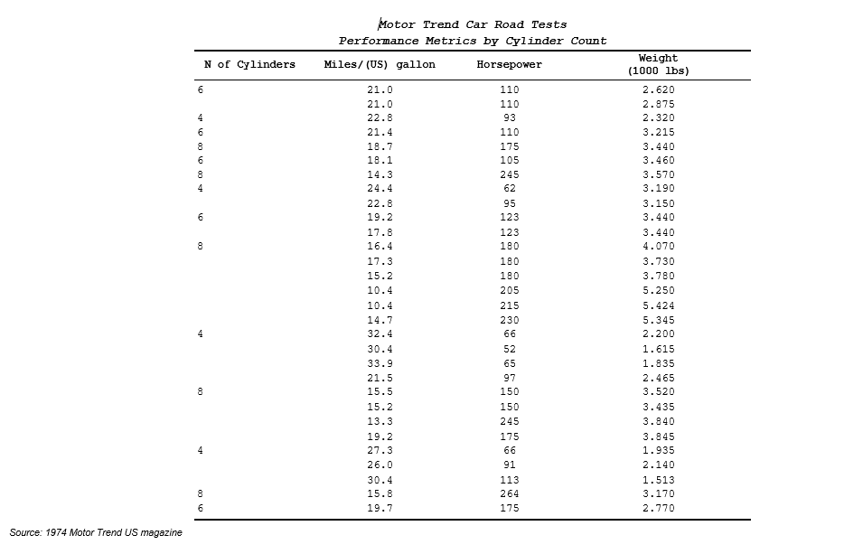
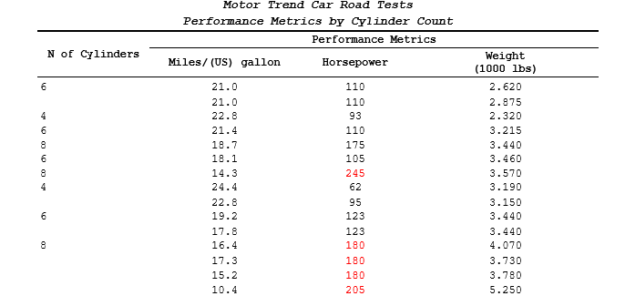
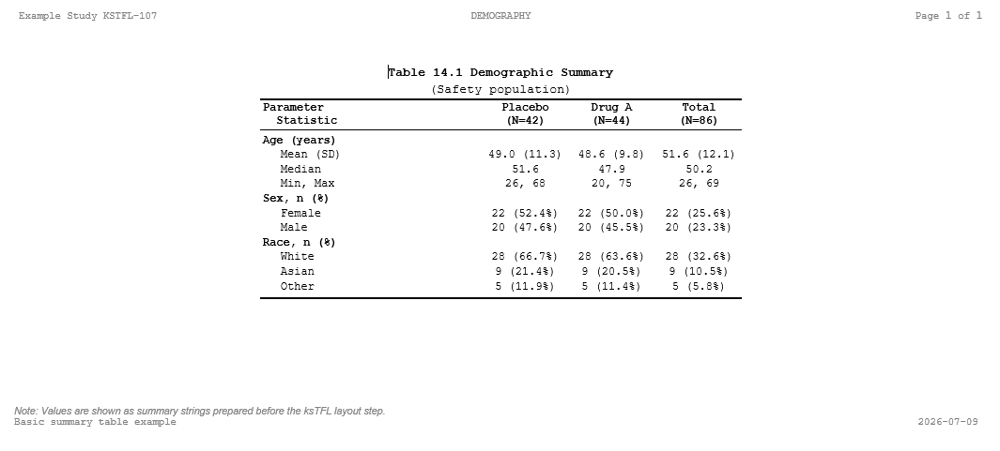

## Introduction

Creating clinical trial tables, figures, and listings is one of the most time-consuming tasks in clinical statistical programming. The [ksTFL R Package](https://crow16384.r-universe.dev/ksTFL) was designed to make this process faster, more reliable, and more enjoyable.

In this post, we'll walk through the basics of ksTFL and create your first clinical table.

## Why ksTFL?

Clinical trial deliverables require:

- ✅ Professional formatting and alignment with regulatory standards
- ✅ Reproducible, auditable code
- ✅ Traceability of the data throughout the analysis pipeline
- ✅ Submission-ready output without manual refinement

Without a specialized tool, generating submission-ready tables and figures from R can require significant time—sometimes more than the time spent on statistical calculations and modeling itself.

## Installation

Install ksTFL from r-universe:

```{r}
#| include: false
#| eval: false
# Install ksTFL from r-universe
# install.packages("ksTFL", repos = "https://crow16384.r-universe.dev")

# Load the package
library(ksTFL)
library(dplyr)
```

## Your First Table

Let's create a simple demographic summary table using sample data:

```{r}
#| message: false
#| warning: false
#| eval: false
# Use built-in mtcars dataset for simplicity
spec <- create_table(mtcars, cols = c(cyl, mpg, hp, wt)) |>
  add_title("Motor Trend Car Road Tests", styleRef = "i") |>
  add_title("Performance Metrics by Cylinder Count", styleRef = "i") |>
  add_footnote("Source: 1974 Motor Trend US magazine")

# Define columns with labels and styling
spec <- spec |>
  define_cols(c(mpg, hp, wt), 
              label = c("Miles/(US) gallon", "Horsepower", "Weight<br>(1000 lbs)"),
              valueStyleRef = "ac"  # align center
              ) |>
  define_cols(cyl, 
  						label = "N of Cylinders",
              dedupe = T) |>
	set_document(contentWidth = "60%")

# Create report and render to DOCX
report <- create_report(spec)
write_doc(report, name = "demo_table", outDir = "output")
```

### What's Happening?

1.  **`create_table(data, cols = ...)`** - Initialize the table with selected columns
2.  **`add_title()`, `add_footnote()`** - Add documentation and annotations
3.  **`define_cols()`** - Configure column properties (labels, styling, visibility, deduplication, etc.)
4.  **`create_report()`** - Assemble the table specification
5.  **`write_doc()`** - Render to a professional DOCX document

With just a few lines of code, ksTFL generates a well-formatted MS Word DOCX document:

{fig-align="center"}

## Key Features

### Declarative Styling

Apply styles without modifying source data:

```{r}
#| eval: false
#| message: false
#| warning: false
# Add conditional styling - highlight high horsepower
spec <- spec |>
  compute_cols(hp >=180, 
               c_style(hp, styleRef = "fc_red"))  # font color red
```

The ksTFL package includes many pre-defined atomic styles, but custom styles can also be created using the `add_style()` function.

### Spanning Headers

Create multi-column group headers:

```{r}
#| eval: false
#| message: false
#| warning: false
spec <- spec |>
  add_span_header(cols = c(mpg, hp, wt), 
                  label = "Performance Metrics")
```

{fig-align="center"}

### Flexible Column Selection

Use tidyselect helpers for column selection:

```{r}
#| eval: false
#| message: false
#| warning: false
spec |>
  define_cols(starts_with("m"), 
              valueStyleRef = "ar")  # right align
```

### Built-in Style Atoms

Combine predefined styles for quick formatting:

```{r}
#| eval: false
#| message: false
#| warning: false
# Combine multiple style attributes
spec <- add_title(spec, "Summary", 
                  styleRef = f_combine("i", "b", "fc_navy"))
```

## Complete Example: Demographics Table

Let's build a submission-ready demographics table.

Since this article focuses on ksTFL's rendering capabilities, the statistical calculations and data preparation are handled upstream. ksTFL does not calculate statistics by itself; rather, it transforms pre-calculated summary tables into publication-ready documents. In production code, statisticians prepare the summary data in a planar format, and ksTFL handles the table layout and formatting.

Below, we use a simple function that generates a data frame with calculated statistics for Age, Sex, and Race:

```{r}
#| message: false
#| warning: false

# Simple function that generates the summary table
# that a statistical programmer typically creates from ADSL data
generate_demography_summary <- function(seed = 1007L) {
	set.seed(seed)
	
	rnd_stat <- function(N) {
		c(
			sprintf("%.1f (%.1f)", rnorm(1L, 48, 2), rnorm(1L, 11, 1)),
			sprintf("%.1f", rnorm(1L, 49, 2)),
			sprintf("%d, %d", sample(20:30, 1L), sample(65:75, 1L)),
			sprintf("%d (%.1f%%)", 22L, 100 * 22L / N),
			sprintf("%d (%.1f%%)", 20L, 100 * 20L / N),
			sprintf("%d (%.1f%%)", 28L, 100 * 28L / N),
			sprintf("%d (%.1f%%)", 9L, 100 * 9L / N),
			sprintf("%d (%.1f%%)", 5L, 100 * 5L / N)
		)
	}
	
	data.frame(
		PARAM = c(rep("Age (years)",3), rep("Sex",2), rep("Race",3)),
		STATISTIC = c("Mean (SD)", "Median", "Min, Max", 
									"Female", "Male", 
									"White", "Asian", "Other"),
		PLACEBO = rnd_stat(placebo_n),
		DRUGA = rnd_stat(drug_a_n),
		TOTAL = rnd_stat(total_n),
		stringsAsFactors = FALSE
	)
}

```

With the inputs provided above, the generated data frame looks like this:

```{r}
placebo_n <- 42L
drug_a_n <- 44L
total_n <- placebo_n + drug_a_n

table_data <- generate_demography_summary(seed = 1007L)

table_data
```

Now let's use ksTFL to transform this planar data frame into a submission-ready document:

```{r}
#| message: false
#| warning: false
#| eval: false

# Initialize ksTFL table specification
table_spec <- create_table(table_data) |>
	# PARAM is set to invisible because we use it as a category header.
	# This keeps the table compact and maintains a professional appearance.
	define_cols(PARAM, label = "Parameter", isVisible = FALSE) |>
	# STATISTIC remains visible on every row because it distinguishes
	# different statistics within each parameter block.
	define_cols(STATISTIC, 
					label = "Parameter<br>Statistic", 
					valueStyleRef = "indent_1", labelStyleRef = 'al') |>
	# Treatment columns follow the same display rules, so we define them together.
	# Although ksTFL calculates column widths automatically,
	# we manually set them here to ensure consistent treatment column widths
	# across the output for visual clarity and professional presentation.
	define_cols(c(PLACEBO, DRUGA, TOTAL),
							label = c(paste0("Placebo<br>(N=", placebo_n,')'), 
												paste0("Drug A<br>(N=", drug_a_n,')'), 
												paste0("Total<br>(N=", total_n,')')),
							valueStyleRef = "ac",
							colWidth = c("18%", "18%", "18%")
	) |>
	compute_cols(
	# The input data lacks units for categorical statistics;
	# we add them dynamically here.
		PARAM %in% c('Sex', 'Race'),
		c_glue(PARAM, 'after', text=', n (%)')
	) |>
	# Use PARAM values as heading rows for better structure
	compute_cols(
		firstOf(PARAM),
		c_addrow('above', value_from = PARAM, styleRef = f_combine('al', 'b'))
	) |>
	# Define titles, subtitles, and document headers/footers
	add_title("Table 14.1 Demographic Summary") |>
	add_subtitle("(Safety Population)", styleRef = 'ac') |>
	add_footnote("Note: Values are presented as summary statistics prepared before the ksTFL stage.") |>
	add_header("Example Study KSTFL-107", "DEMOGRAPHY", "Page {PAGE} of {NUMPAGES}") |>
	add_footer("Basic summary table example", "", format(Sys.Date(), "%Y-%m-%d")) |>
	# Demographic tables benefit from a moderate content width:
	# narrow enough to keep treatment columns readable, but wide enough
	# to avoid sparse layouts with few rows.
	set_document(
		contentWidth = "50%",
		# ksTFL provides flexible control over footnote placement:
		# "doc_footer" (in the Word footer below footer rows),
		# "repeated" (under the table on every page), or
		# "last_page" (under the table on the last page only)
		footnotePlace = "doc_footer" 
	)

# Create report and render to DOCX
report <- create_report(table_spec)

write_doc(report, name = "table_14_1", outDir = "output")

```

With just a few lines of declarative code, the planar data frame transforms into a production-ready document:

{fig-align="center"}

The key advantage of this approach is that the input data remains in a simple, planar format that is easy to validate and audit, without any embedded reporting artifacts or formatting logic.

## Next Steps

Now that you understand the basics of ksTFL, you can:

\- Explore the [ksTFL Documentation](https://crow16384.github.io/ksTFL/) for advanced features

\- Check out the [GitHub Repository](https://github.com/al-garik/ksTFL-examples) for more real examples and scripts

\- A LinkedIn Post [here](https://www.linkedin.com/feed/update/urn:li:activity:7479853700828811264/?utm_source=share&utm_medium=member_desktop&rcm=ACoAAAUzuu4BEDY7577xOkwgYzheanx_vKn89pk) gives some additional context and background on the ksTFL package.

------------------------------------------------------------------------

Aleschenkov I, Larchenko V (2026). *ksTFL: Framework for Clinical Tables, Figures, and Listings*. R package version 0.11.9, <https://crow16384.github.io/ksTFL/> <https://crow16384.r-universe.dev/ksTFL>.

