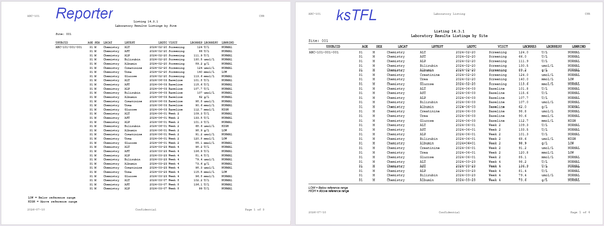
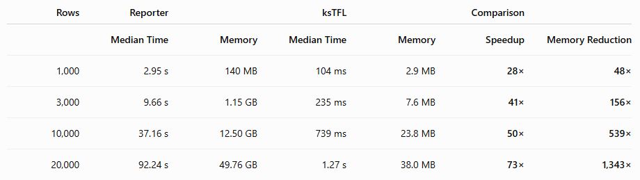

When you're creating a few tables for a publication or an exploratory analysis, report generation time usually isn't something you think about. If a table takes a couple of seconds to produce, you simply move on to the next task.

Clinical trial reporting is different.

A typical CSR may contain hundreds of Tables, Figures and Listings (TFLs). Interim analyses, reruns after database updates, quality control cycles, programming reviews, and production runs, and suddenly those "few extra seconds" become hours of waiting.

Performance is no longer just a nice-to-have feature—it directly affects programmer productivity.

To see how much difference the reporting engine itself can make, I compared one of the most widely used clinical reporting packages in R, *Reporter*, with the newly released *ksTFL* package.

## Benchmark setup

The goal was to compare the document generation engines rather than data preparation or statistical computation.

A realistic laboratory listing dataset was generated with dummy data containing: 10 investigative sites, 20 subjects per site, Subject demographics (Age and Sex), Laboratory category (Chemistry and Hematology), Laboratory parameter, Assessment date, Visit, Laboratory result, Unit, and Low / Normal / High indicator

```         
   SITE         USUBJID AGE SEX     LBCAT     LBTEST      LBDTC     VISIT LBORRES LBORRESU LBNRIND
1   001 ABC-101-001-001  31   M Chemistry        ALT 2024-02-20 Screening   124.0      U/L  NORMAL
2   001 ABC-101-001-001  31   M Chemistry        AST 2024-02-20 Screening    66.0      U/L  NORMAL
3   001 ABC-101-001-001  31   M Chemistry        ALP 2024-02-20 Screening   111.9      U/L  NORMAL
4   001 ABC-101-001-001  31   M Chemistry  Bilirubin 2024-02-20 Screening   130.5   umol/L  NORMAL
5   001 ABC-101-001-001  31   M Chemistry    Albumin 2024-02-20 Screening    89.2      g/L  NORMAL
6   001 ABC-101-001-001  31   M Chemistry Creatinine 2024-02-20 Screening   124.0   umol/L  NORMAL
7   001 ABC-101-001-001  31   M Chemistry       Urea 2024-02-20 Screening   140.0   mmol/L     LOW
8   001 ABC-101-001-001  31   M Chemistry    Glucose 2024-02-20 Screening   113.6   mmol/L  NORMAL
9   001 ABC-101-001-001  31   M Chemistry        ALT 2024-06-03  Baseline   101.8      U/L  NORMAL
10  001 ABC-101-001-001  31   M Chemistry        AST 2024-06-03  Baseline   115.6      U/L  NORMAL
```

The following functions were created to run with the `bench` package.

### Reporter

```{r}
#| include: true
#| eval: false

library(reporter)

reporter_bench <- function(nrows) {

tbl <- create_table(lab |> head(nrows)) |>
	page_by(SITE,	label="Site: ") |>
	define('SITE', visible = F) |>
	define('USUBJID', dedupe = T)

rpt <-
	create_report(
		"Reporter_LabListing.rtf",	output_type="RTF",
		font="Courier",	font_size=8
	) |>
	page_header(
		left="ABC-101",
		center="Laboratory Listing",
		right="CSR"
	) |>
	titles("Listing 14.3.1","Laboratory Results Listings by Site"	) |>
	add_content(tbl) |>
	footnotes(
		"LOW = Below reference range",
		"HIGH = Above reference range"
	) |>
	page_footer(
		left=format(Sys.Date()),
		center="Confidential",
		right="Page [pg] of [tpg]"
	)

	write_report(rpt)
	
}
```

### ksTFL

```{r}
#| include: true
#| eval: false

library(ksTFL)

ksTFL_bench <- function(nrows) {

data <- lab |> head(nrows)

listing <- create_table(data) |>
	add_header(	c("ABC-101","Laboratory Listing","CSR")) |>
  add_footer(c(format(Sys.Date()), "Confidential", "Page {PAGE} of {NUMPAGES}")) |>
	add_title(c("Listing 14.3.1",	"Laboratory Results Listings by Site")) |>
	add_subtitle("Site: #ByGroup1") |>
	add_footnote(c("LOW = Below reference range", "HIGH = Above reference range")) |>
	define_cols(SITE, isVisible = F, isGrouping = T) |>
	define_cols(USUBJID, dedupe = T)

rep <- create_report(listing)
write_doc(rep, 'ksTFL_LabListing')

}
```

Both packages generated essentially the same report:

- Laboratory data listing
- Paginated by Site Number
- Standard clinical titles
- Dynamic subtitle with Site Number
- Page headers and footers
- Footnotes
- Default formatting

Here are the side-by-side view of the first page of the created documents:

{fig-align="center"}

The benchmark was repeated using datasets containing 1000, 3000, 10000, and 20000 listing records. Each benchmark was executed twice, and the median execution time was reported.

```{r}
#| include: true
#| eval: false
library(bench)

sizes <- c(1000, 3000, 10000, 20000)

results <-
	bind_rows(
		lapply(sizes, function(n) {
			
			cat("Benchmarking", n, "rows...\n")
			
			x <-
				bench::mark(
					Reporter = reporter_bench(n),
					ksTFL    = ksTFL_bench(n),
					iterations = 2,
					check = FALSE,
					memory = TRUE,
					time_unit = "s"
				)
			
			x$nrows <- n
			
			x
		})
	)

```

Here are the results:

{fig-align="center"}

## What stands out?

The difference is immediately noticeable.

Even for a relatively small listing of **1,000 rows**, **ksTFL** completed report generation in just over **100 milliseconds**, while **Reporter** required almost **3 seconds**.

As the listing size increased, the performance gap widened considerably.

For **20,000 rows**, Reporter required more than **one and a half minutes** to generate the report, whereas ksTFL completed the same task in just over **one second**.

More interestingly, the advantage isn't constant—it increases with report size:

-  ksTFL **28× faster** for 1,000 rows

-  **41× faster** for 3,000 rows

-  **50× faster** for 10,000 rows

-  **73× faster** for 20,000 rows

This suggests that the ksTFL reporting engine scales much more efficiently as document size grows.

## Memory usage tells an even bigger story

Execution time is only part of the picture.

The amount of memory allocated during report generation increases rapidly for Reporter as the listing becomes larger.

For the largest benchmark Reporter allocated nearly **50 GB** of memory while ksTFL required **only 38 MB** 

Lower memory consumption isn't just an interesting benchmark statistic. It means:

-  reduced risk of exhausting available memory,

-  better performance on virtual machines and shared servers,

-  and the ability to generate multiple reports in parallel without competing for system resources.


## Why does this matter?

In real-world clinical reporting, the document generation step is only one part of the overall workflow. Data preparation, derivations and statistical analyses often account for a large proportion of the total runtime.

However, once the analysis datasets are ready, the reporting engine becomes the final stage and sometimes repeated over and over again.

During study development, programmers regenerate reports after every change, QC programmers independently recreate the same outputs, and complete production runs are repeated for interim analyses, database updates and final deliverables.

A study containing a few hundred outputs may therefore generate **thousands of report files** over its lifetime.

Even if each individual report saves only a few seconds, those savings accumulate into hours of reduced waiting time for programmers and much faster production cycles.

## Final thoughts

Performance isn't the only criterion when selecting a reporting framework. Functionality, output quality, flexibility and ease of use are equally important.

Nevertheless, report generation speed becomes increasingly valuable as studies become larger and reporting workflows become more automated.

One particularly interesting observation from this benchmark is that **the performance advantage of ksTFL grows as report size increases**. Rather than maintaining a constant lead, ksTFL becomes progressively faster relative to Reporter while simultaneously requiring dramatically less memory.

Although this benchmark focuses on a laboratory listing, the results indicate that the underlying document generation engine scales efficiently and remains responsive even for substantially larger reports.

If your reporting workflow involves generating hundreds of outputs throughout the lifetime of a clinical trial, those gains can translate into noticeably shorter development cycles, faster production runs, and a smoother experience for the programming team.

-----

*Benchmark environment:* Both packages were executed on the same machine using the same input data and comparable report layouts. Each benchmark was run **twice**, with the **median execution time** reported. The benchmark was designed to measure the performance of the reporting engine itself, not the time required for data preparation or statistical analyses.

------------------------------------------------------------------------

```         
Aleschenkov I, Larchenko V (2026). _ksTFL: Framework for Clinical Tables,
  Figures, and Listings_. R package version 0.11.9,
  <https://crow16384.github.io/ksTFL/,https://crow16384.r-universe.dev/ksTFL>
```

*This post was originally published on the KeyStat Solutions R Technical Blog. [Visit R-Bloggers](https://www.r-bloggers.com) to discover more R content.*
