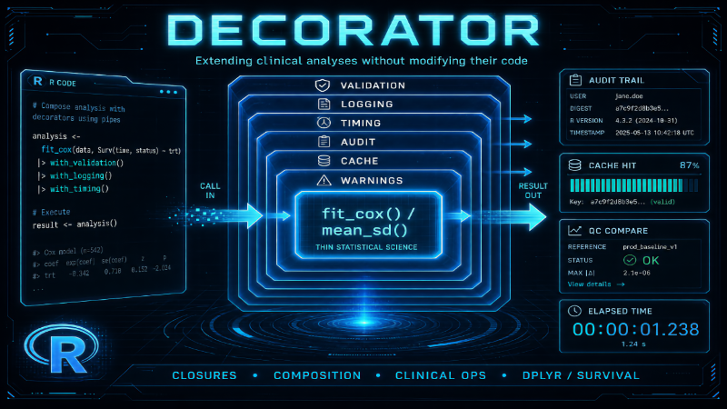

{fig-align="center"}

# Introduction

The **Decorator** pattern (Gamma et al., 1994) is one of the most
practical Gang of Four (GoF) patterns for statistical programming.

The idea is simple:

> Attach additional behaviour to an existing object or function
> **without modifying its implementation**.

In clinical studies that separation matters because scientific
algorithms change slowly while infrastructure requirements keep growing.
A thin demography or Cox fit eventually needs logging, validation,
timing, audit trails, caching, QC comparison, and export — none of which
belong inside the statistical core.

Instead of rewriting every analysis, those responsibilities become
**decorators**: higher-order functions that wrap an analysis and return
a new function with the same call shape.

```{r}
#| label: packages
library(dplyr, warn.conflicts = FALSE)
library(tidyr)
library(purrr)
library(survival)
library(digest)
```

# Motivation

Start with a tidy demography summary — scientific logic only:

```{r}
#| label: mean-sd-core
mean_sd_by_trt <- function(data) {
  data |>
    group_by(TRT01P) |>
    summarise(
      n = sum(!is.na(AGE)),
      mean_age = mean(AGE, na.rm = TRUE),
      sd_age = sd(AGE, na.rm = TRUE),
      .groups = "drop"
    )
}
```

Months later the project also wants:

```text
Validate input
  → Log execution
  → Measure elapsed time
  → Capture warnings
  → Write an audit trail
  → Cache results
  → Compare against an independent QC run
  → Export display artefacts
```

If all of that is pasted into `mean_sd_by_trt()`, the function is
dominated by infrastructure. The Decorator pattern keeps the science
thin and stacks operational concerns outside.

# Structure

Decorators wrap **outward**. Composition order in a pipe is the order
wrappers are applied; the **outermost** decorator runs first on each
call.

```{mermaid}
%%| label: decorator-stack
%%| fig-width: 6.5
%%| fig-asp: 0.18
%%| out-width: "100%"
%%{init: {"theme": "neutral", "flowchart": {"rankSpacing": 36, "nodeSpacing": 16, "padding": 4}}}%%
flowchart LR
  callNode[CallAnalysis] --> val[Validation]
  val --> logNode[Logging]
  logNode --> timing[Timing]
  timing --> core[MeanSdByTrt]
  core --> resultNode[Result]
```

| Nearby idea | Role |
|---|---|
| Inheritance explosion | `AnalysisWithLoggingAndTimingAnd…` subclasses |
| Middleware pipeline | Ordered request/response stages (often evolves *from* decorators) |
| Adapter | Normalises *data* interfaces; Decorator extends *behaviour* |
| Strategy | Swappable scientific method; Decorator adds orthogonal concerns |

# Functional Decorators in R

Functions are first-class in R, so a decorator is naturally a function
that takes a function and returns a function.

## Logging

```{r}
#| label: with-logging
with_logging <- function(fun, label = "analysis") {
  function(...) {
    message(sprintf("[%s] started", label))
    result <- fun(...)
    message(sprintf("[%s] finished", label))
    result
  }
}
```

## Timing

```{r}
#| label: with-timing
with_timing <- function(fun) {
  function(...) {
    t0 <- proc.time()[["elapsed"]]
    result <- fun(...)
    elapsed <- proc.time()[["elapsed"]] - t0
    message(sprintf("Elapsed: %.3f s", elapsed))
    result
  }
}
```

## Validation

```{r}
#| label: with-validation
with_validation <- function(fun, required = character()) {
  function(data, ...) {
    stopifnot(is.data.frame(data), nrow(data) > 0)
    missing <- setdiff(required, names(data))
    if (length(missing) > 0) {
      stop(
        "Missing required columns: ",
        paste(missing, collapse = ", "),
        call. = FALSE
      )
    }
    fun(data, ...)
  }
}
```

## Warning capture

Statistical procedures often emit warnings. Capture and muffle them so
callers can decide how to report:

```{r}
#| label: with-warning-capture
with_warning_capture <- function(fun) {
  function(...) {
    warnings <- character()
    result <- withCallingHandlers(
      fun(...),
      warning = function(w) {
        warnings <<- c(warnings, conditionMessage(w))
        invokeRestart("muffleWarning")
      }
    )
    list(result = result, warnings = warnings)
  }
}
```

**Interface note.** Decorators that only forward (`with_logging`,
`with_timing`, `with_validation`) preserve the analysis return type.
`with_warning_capture` and `with_audit` change the return shape to a
list — place them **outermost** when you need that metadata.

## Audit trail

```{r}
#| label: with-audit
with_audit <- function(fun, analysis_id = "analysis") {
  function(data, ...) {
    t0 <- Sys.time()
    result <- fun(data, ...)
    meta <- list(
      analysis_id = analysis_id,
      user = Sys.info()[["user"]],
      started = t0,
      finished = Sys.time(),
      n_rows = nrow(data),
      data_digest = digest(data),
      r_version = R.version.string,
      git_sha = Sys.getenv("GIT_SHA", unset = NA_character_)
    )
    list(result = result, audit = meta)
  }
}
```

## Caching

```{r}
#| label: with-cache
with_cache <- function(fun, cache_dir = tempdir(), prefix = "decor") {
  if (!dir.exists(cache_dir)) {
    dir.create(cache_dir, recursive = TRUE)
  }
  function(data, ...) {
    key <- digest(list(data = data, dots = list(...)))
    path <- file.path(cache_dir, paste0(prefix, "-", key, ".rds"))
    if (file.exists(path)) {
      message("Cache hit: ", basename(path))
      return(readRDS(path))
    }
    message("Cache miss — running analysis")
    result <- fun(data, ...)
    saveRDS(result, path)
    result
  }
}
```

## Composition

Pipe order = wrap order. Below, validation is outermost; timing sits
closest to the scientific core:

```{r}
#| label: compose-demo
demo_adsl <- tibble(
  USUBJID = sprintf("P%03d", 1:12),
  AGE = c(45, 52, 38, 61, 49, 55, 41, 58, 47, 53, 36, 62),
  TRT01P = rep(c("Placebo", "Drug A"), each = 6)
)

analysis_demo <- mean_sd_by_trt |>
  with_validation(required = c("AGE", "TRT01P")) |>
  with_logging(label = "mean_sd_by_trt") |>
  with_timing()

analysis_demo(demo_adsl)
```

Nothing inside `mean_sd_by_trt()` changed.

# Example A: demography with a production stack

Build a stack that validates, logs, times, audits, and captures
warnings:

```{r}
#| label: example-a
#| message: true
demog_pipeline <- mean_sd_by_trt |>
  with_validation(required = c("AGE", "TRT01P")) |>
  with_logging(label = "demog") |>
  with_timing() |>
  with_audit(analysis_id = "T14.1.1_AGE") |>
  with_warning_capture()

demog_out <- demog_pipeline(demo_adsl)
demog_out$result$result
demog_out$result$audit[c("analysis_id", "n_rows", "data_digest", "r_version")]
demog_out$warnings
```

Because `with_audit` returns `list(result, audit)` and
`with_warning_capture` wraps that, the scientific tibble lives at
`$result$result`. That nesting is the price of stacking metadata
decorators — or unwrap once at the reporting boundary.

Validation fails early without touching the core:

```{r}
#| label: example-a-fail
#| error: true
tryCatch(
  demog_pipeline(select(demo_adsl, USUBJID, TRT01P)),
  error = function(e) conditionMessage(e)
)
```

# Example B: tidy laboratory summaries

Wide lab snapshots become long analysis rows with `tidyr`. The science
stays a pure summarise; validation and timing are reusable:

```{r}
#| label: example-b-data
demo_labs_wide <- tibble(
  USUBJID = sprintf("P%03d", 1:8),
  TRT01P = rep(c("Placebo", "Drug A"), each = 4),
  AVISIT = rep(c("Baseline", "Week 4"), times = 4),
  ALT = c(28, 41, 22, 55, 31, 48, 19, 62),
  AST = c(24, 38, 21, 49, 27, 44, 18, 57),
  CREAT = c(0.9, 1.1, 0.8, 1.3, 1.0, 1.2, 0.7, 1.4)
)

lab_means_by_trt_visit <- function(data) {
  data |>
    pivot_longer(
      cols = c(ALT, AST, CREAT),
      names_to = "PARAMCD",
      values_to = "AVAL"
    ) |>
    group_by(TRT01P, AVISIT, PARAMCD) |>
    summarise(
      n = sum(!is.na(AVAL)),
      mean_aval = mean(AVAL, na.rm = TRUE),
      sd_aval = sd(AVAL, na.rm = TRUE),
      .groups = "drop"
    ) |>
    arrange(PARAMCD, AVISIT, TRT01P)
}

lab_pipeline <- lab_means_by_trt_visit |>
  with_validation(
    required = c("TRT01P", "AVISIT", "ALT", "AST", "CREAT")
  ) |>
  with_timing()

lab_pipeline(demo_labs_wide)
```

The same `with_validation` / `with_timing` helpers apply to demography
and labs — the Decorator win is **reuse across analyses**, not a new
OO hierarchy per table.

# Example C: Cox proportional hazards

Thin model code:

```{r}
#| label: example-c-core
fit_cox_trt <- function(data) {
  survival::coxph(
    survival::Surv(TIME, CNSR == 0) ~ TRT01P,
    data = data,
    ties = "efron"
  )
}

set.seed(20260807)
demo_adtte <- tibble(
  USUBJID = sprintf("P%03d", 1:40),
  TRT01P = rep(c("Placebo", "Drug A"), each = 20),
  TIME = c(rexp(20, rate = 1 / 18), rexp(20, rate = 1 / 26)),
  CNSR = c(rbinom(20, 1, 0.35), rbinom(20, 1, 0.40))
)

cox_pipeline <- fit_cox_trt |>
  with_validation(required = c("TIME", "CNSR", "TRT01P")) |>
  with_logging(label = "cox_trt") |>
  with_timing() |>
  with_warning_capture()

cox_out <- cox_pipeline(demo_adtte)
summary(cox_out$result)$coefficients
cox_out$warnings
```

`fit_cox_trt()` contains only the model. Production logging, timing,
and warning capture sit outside — the same stack can wrap a logistic
model or an MMRM helper tomorrow.

# Example D: caching a bootstrap contrast

Bootstrap mean differences are expensive relative to a hash lookup.
Decorate once; repeated identical calls hit the cache:

```{r}
#| label: example-d
#| message: true
bootstrap_mean_diff <- function(data, n_boot = 400L, seed = 1L) {
  set.seed(seed)
  arms <- sort(unique(data$TRT01P))
  stopifnot(length(arms) == 2L)
  diffs <- map_dbl(seq_len(n_boot), function(i) {
    boot <- data |>
      group_by(TRT01P) |>
      slice_sample(prop = 1, replace = TRUE) |>
      ungroup()
    m <- boot |>
      group_by(TRT01P) |>
      summarise(m = mean(AGE, na.rm = TRUE), .groups = "drop")
    m$m[m$TRT01P == arms[[2]]] - m$m[m$TRT01P == arms[[1]]]
  })
  tibble(
    arm_ref = arms[[1]],
    arm_cmp = arms[[2]],
    mean_diff = mean(diffs, na.rm = TRUE),
    se = sd(diffs, na.rm = TRUE),
    p025 = quantile(diffs, 0.025, names = FALSE, na.rm = TRUE),
    p975 = quantile(diffs, 0.975, names = FALSE, na.rm = TRUE)
  )
}

cache_dir <- file.path(tempdir(), "decorator-cache")
boot_cached <- bootstrap_mean_diff |>
  with_validation(required = c("AGE", "TRT01P")) |>
  with_cache(cache_dir = cache_dir, prefix = "boot-age") |>
  with_timing()

t1 <- system.time(r1 <- boot_cached(demo_adsl, n_boot = 400L, seed = 1L))
t2 <- system.time(r2 <- boot_cached(demo_adsl, n_boot = 400L, seed = 1L))
identical(r1, r2)
c(first_s = unname(t1[["elapsed"]]), second_s = unname(t2[["elapsed"]]))
r1
```

Useful for bootstrap, simulation, PK, and Bayesian refits when inputs
are unchanged.

# QC and export decorators (architecture)

## Independent QC

A QC decorator does not embed SAS or a second R engine inside the
scientific function. It **orchestrates** two result producers and
compares:

```text
Primary analysis(data)
  → Independent QC analysis(data)   # separate script / batch / team
  → Compare key columns / digits
  → Write QC report
  → Return primary result (+ QC status)
```

Sketch (both sides in R for illustration):

```{r}
#| label: qc-sketch
with_qc_compare <- function(fun, qc_fun, tol = 1e-8) {
  function(data, ...) {
    primary <- fun(data, ...)
    qc <- qc_fun(data, ...)
    # Align on common columns for a simple numeric check
    common <- intersect(names(primary), names(qc))
    num_cols <- common[map_lgl(primary[common], is.numeric)]
    deltas <- map_dbl(num_cols, function(col) {
      max(abs(primary[[col]] - qc[[col]]), na.rm = TRUE)
    })
    status <- all(deltas <= tol, na.rm = TRUE)
    list(
      result = primary,
      qc_ok = status,
      max_abs_delta = if (length(deltas)) max(deltas) else NA_real_
    )
  }
}

# "Independent" QC: same science, slightly different implementation
mean_sd_by_trt_qc <- function(data) {
  data |>
    summarise(
      n = sum(!is.na(AGE)),
      mean_age = mean(AGE, na.rm = TRUE),
      sd_age = sd(AGE, na.rm = TRUE),
      .by = TRT01P
    ) |>
    arrange(match(TRT01P, unique(data$TRT01P)))
}

qc_pipeline <- mean_sd_by_trt |>
  with_validation(required = c("AGE", "TRT01P")) |>
  with_qc_compare(qc_fun = mean_sd_by_trt_qc)

qc_out <- qc_pipeline(demo_adsl)
qc_out$qc_ok
qc_out$max_abs_delta
qc_out$result
```

A production decorator would call an external QC artefact (SAS listing,
locked CSV, validated package) instead of `mean_sd_by_trt_qc`.

## Export

Export belongs at the boundary, not inside the model:

```{r}
#| label: export-sketch
with_csv_export <- function(fun, path) {
  function(...) {
    result <- fun(...)
    to_write <- if (is.data.frame(result)) {
      result
    } else if (is.list(result) && is.data.frame(result$result)) {
      result$result
    } else {
      stop("Export decorator expects a data frame result", call. = FALSE)
    }
    utils::write.csv(to_write, path, row.names = FALSE)
    message("Wrote ", path)
    result
  }
}
```

Prefer a dedicated renderer such as
[ksTFL](https://crow16384.github.io/ksTFL/) for submission DOCX rather
than growing ad hoc `write_rtf` / `write_pdf` branches inside every
analysis.

# Application to ksTFL

Decorator fits a **reporting pipeline** around a declarative table
spec — not around estimand science:

```{mermaid}
%%| label: kstfl-decorators
%%| fig-width: 6.5
%%| fig-asp: 0.16
%%| out-width: "100%"
%%{init: {"theme": "neutral", "flowchart": {"rankSpacing": 28, "nodeSpacing": 12, "padding": 4}}}%%
flowchart LR
  spec[TFLspec] --> validate[ValidateSpec]
  validate --> logNode[Log]
  logNode --> timer[Timer]
  timer --> audit[Audit]
  audit --> qc[QCCompare]
  qc --> render[write_doc]
  render --> docx[DOCX]
```

As in the Visitor article: ksTFL separates planar analysis data from
presentation metadata. Decorators wrap **validate / log / time / audit /
QC / render** around that boundary. They should not turn every TFL into
an OO class with `accept(HtmlVisitor)`.

Illustrative shape (not executed):

```{r}
#| label: kstfl-decor-sketch
#| eval: false
render_table <- function(spec, out_dir) {
  report <- ksTFL::create_report(spec)
  ksTFL::write_doc(report, name = "t14_01_01", outDir = out_dir)
}

render_prod <- render_table |>
  with_logging(label = "t14.1.1") |>
  with_timing() |>
  with_audit(analysis_id = "T14.1.1")
```

# Relationship to Other Patterns

```{mermaid}
%%| label: pattern-neighbours
%%| fig-width: 6.5
%%| fig-asp: 0.28
%%| out-width: "100%"
%%{init: {"theme": "neutral", "flowchart": {"rankSpacing": 32, "nodeSpacing": 18, "padding": 4}}}%%
flowchart LR
  facade[Facade] --> builder[Builder]
  builder --> decorator[Decorator]
  decorator --> strategy[Strategy]
  strategy --> analysis[AnalysisCore]
  adapter[Adapter] --> analysis
  decorator --> analysis
```

| Pattern | Concern |
|---|---|
| **Adapter** | Vendor / study column and code interfaces |
| **Strategy** | Choice of estimand or model among peers |
| **Builder / Facade** | Assemble a reporting or analysis façade |
| **Decorator** | Orthogonal ops: log, time, audit, cache, QC |
| **Visitor** | Many operations over a stable object graph |

Decorator composes especially well with Strategy (swap the core) and
Adapter (feed a normalised tibble into a decorated analysis).

# Advantages

- Separation of scientific and operational concerns
- Reusable infrastructure across analyses
- Smaller, testable statistical functions
- Flexible composition per environment (dev vs production)
- Natural home for regulatory audit metadata

# Limitations

Long chains are harder to debug: errors and return shapes may originate
several wrappers above the core. Prefer:

- few, well-named decorators;
- outermost metadata wrappers documented once;
- logging that prints which layer is active.

```text
Validation → Logging → Timing → Caching → Warnings → Audit → Analysis
```

# Decorator versus Inheritance

Without Decorator, optional features explode into subclasses:

```text
Analysis
  → AnalysisWithLogging
  → AnalysisWithLoggingAndTiming
  → AnalysisWithLoggingTimingValidation
  → …
```

Decorators compose *n* behaviours with *n* wrappers instead of
$2^n$ subclasses.

# Decorator versus Middleware

A decorator wraps **one** function. Middleware manages a shared
request/response pipeline (validation → auth → cache → handler). Many
clinical systems start with decorators and grow into middleware when
every endpoint shares the same stages.

# When not to use Decorator

- One-off scripts where a few `message()` lines suffice
- Changing the scientific estimand — that is Strategy, not decoration
- Permanent data harmonisation — Adapter or ETL
- Submission TFL layout — declarative specs (ksTFL), not export
  decorators stacked on model objects
- When the return-type nesting of metadata wrappers costs more than it
  saves — unwrap at one façade instead

# Closing

| Situation | Prefer |
|---|---|
| Same science, more ops (log / time / audit / cache) | Decorator stack |
| Swap Cox vs parametric survival | Strategy |
| Vendor column / code differences | Adapter |
| Walk subject graphs for QC / incidence | Visitor or S3 generics |
| Submission-quality DOCX TFLs | ksTFL declarative render |
| Shared stages across many endpoints | Middleware pipeline |

# Summary

The Decorator pattern adds behaviour **around** statistical functions
without editing them. In clinical programming that yields thin model and
summary code, reusable validation and audit layers, optional caching for
expensive resampling, and QC/export hooks at the boundary.

Among GoF patterns, Decorator is especially valuable because it
separates **scientific logic** from **operational concerns**, so the
same analysis can run in development, validation, and production with
different stacks — simply by changing which wrappers are applied.

Related posts in this series: Adapter (vendor interfaces) and Visitor
(operations over clinical object graphs).

# References

- Gamma, E., Helm, R., Johnson, R., and Vlissides, J. (1994).
  *Design Patterns: Elements of Reusable Object-Oriented Software*.
  Addison-Wesley.
- ksTFL documentation:
  <https://crow16384.github.io/ksTFL/>
