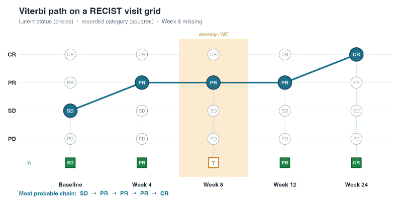

{fig-align="center"}

# Introduction

Oncology trials record tumour response on a visit calendar:
Baseline $\rightarrow$ Week 4 $\rightarrow$ Week 8 $\rightarrow$
Week 12 $\rightarrow$ Week 24. At each post-baseline assessment the
category is one of CR, PR, SD, or PD.[^1] Scans are missed, windows
are missed, and a visit is coded NE.[^2] The table then looks like

$$
\text{SD} \;\rightarrow\; \text{PR} \;\rightarrow\;
{?} \;\rightarrow\; \text{PR} \;\rightarrow\; \text{CR}.
$$

Last observation carried forward (LOCF) fills the hole with PR.
Copying the neighbour on either side does the same. Neither method
asks whether the completed *chain* is a plausible disease course.

A hidden Markov model (HMM) treats the recorded category as a noisy
or incomplete view of a latent status $s_t$ (Baum and Petrie, 1966;
Rabiner, 1989). The Viterbi algorithm (Viterbi, 1967; Forney, 1973)
returns the **single most probable state sequence** given the
recordings — the MAP[^3] path, not a visit-wise majority vote.

> Restore the chain $s_1 \rightarrow \cdots \rightarrow s_T$ that
> maximises $P(s_{1:T} \mid y_{1:T})$, subject to clinical
> transition structure (PD absorbing, improvement SD $\to$ PR
> $\to$ CR allowed) and to whatever was actually seen.

This article implements that decoder from scratch in R, on a
five-visit RECIST-like grid, including missing visits, unequal
spacing, and a short misclassification extension.

**A RECIST caveat, stated first.** Under RECIST 1.1, Baseline is
the **reference measurement**, not a response category (Therasse et
al., 2000; Eisenhauer et al., 2009). CR/PR/SD/PD are defined
post-baseline against baseline and nadir; confirmation rules and
the 20% + 5 mm PD criterion are operational, not Markov. The
five-point chain below is a **latent status process on the visit
calendar** — a reconstruction and QC tool. It is not a best overall
response (BOR) engine and must not replace the protocol estimand
(ICH E9(R1), 2019).

[^1]: Complete Response, Partial Response, Stable Disease,
Progressive Disease (Eisenhauer et al., 2009).
[^2]: Not evaluable.
[^3]: Maximum a posteriori.

```{r}
#| label: packages
library(dplyr, warn.conflicts = FALSE)
library(tidyr)
library(purrr)
library(ggplot2)
library(expm)
```

# Motivation

Suppose Week 8 is missing and the recorded sequence is
`SD, PR, NA, PR, CR`. In practice the chain gets completed three
ways:

| Method | Completed chain |
|---|---|
| LOCF | SD $\to$ PR $\to$ **PR** $\to$ PR $\to$ CR |
| Copy next | SD $\to$ PR $\to$ **PR** $\to$ PR $\to$ CR |
| Independent draw | whatever the marginal at Week 8 suggests |

LOCF and copy-next agree here only because the recordings flanking
the hole are both PR; they part ways as soon as the next
observation differs from the last.

LOCF is a poor primary analysis for longitudinal *means*
(Siddiqui, Hung, and O'Neill, 2009; National Research Council,
2010; Little et al., 2012). For a *categorical disease course* it
fails a second way: it ignores transition constraints. A sequence
`PD, NA, CR` becomes `PD, PD, CR` under LOCF, which contradicts
absorbing progression. Independent imputation of each visit can
invent the same impossibility.

Rabiner (1989) separates three HMM jobs:

1. likelihood of the recordings given the model;
2. **decoding** — the most probable state sequence (Viterbi);
3. learning the parameters (Baum–Welch / EM; Baum et al., 1970).

This post is job 2. Job 3 is out of scope: the transition matrix
here is protocol-structured, not estimated from the same small
trial we then "complete".

The decoding estimand is a **path**. The forward–backward algorithm
gives the visit-wise posteriors
$$P(S_t = s \mid y_{1:T}),$$
yet the visit-wise modes can disagree with the Viterbi path (Rabiner, 1989;
Cappé, Moulines, and Rydén, 2005). For "what was the most
plausible course of disease?" the path is the right object.

# An HMM on the visit grid

Four latent statuses, in clinical order of worsening. The plate below
is the same five-visit calendar: a Markov chain of hidden statuses
$s_t$ and a recording $y_t$ that may be missing.

```{mermaid}
%%| label: hero-hmm
%%| fig-width: 8.5
%%| fig-height: 4.0
%%| out-width: "100%"
%%{init: {"theme": "base", "themeVariables": {"darkMode": false, "background": "#ffffff", "primaryColor": "#d6eaf8", "primaryTextColor": "#1a252f", "primaryBorderColor": "#1f6f8b", "lineColor": "#2c3e50", "mainBkg": "#d6eaf8", "clusterBkg": "#f7f9fb", "clusterBorder": "#5d6d7e", "titleColor": "#1a252f"}, "flowchart": {"padding": 12, "nodeSpacing": 18, "rankSpacing": 40, "curve": "linear"}}}%%
flowchart LR
  subgraph hidden [Latent status]
    S0["s1"]
    S1["s2"]
    S2["s3"]
    S3["s4"]
    S4["s5"]
    S0 --> S1 --> S2 --> S3 --> S4
  end
  subgraph rec [Recorded RECIST]
    Y0["y1"]
    Y1["y2"]
    Y2["y3 missing"]
    Y3["y4"]
    Y4["y5"]
  end
  S0 --> Y0
  S1 --> Y1
  S2 --> Y2
  S3 --> Y3
  S4 --> Y4
  classDef hid fill:#d6eaf8,stroke:#1f6f8b,color:#1a252f,stroke-width:1.5px
  classDef seen fill:#d5f5e3,stroke:#1e8449,color:#1a252f,stroke-width:1.5px
  classDef miss fill:#fdebd0,stroke:#b9770e,color:#1a252f,stroke-width:1.8px
  class S0,S1,S2,S3,S4 hid
  class Y0,Y1,Y3,Y4 seen
  class Y2 miss
```

```{tikz}
%| label: hero-hmm-pdf
%| echo: false
%| eval: !expr knitr::is_latex_output()
%| fig-align: center
%| fig-width: 6.4
\begin{tikzpicture}[
  font=\sffamily,
  hid/.style={
    draw={rgb,255:red,31;green,111;blue,139},
    fill={rgb,255:red,214;green,234;blue,248},
    very thick, minimum size=8.8mm, inner sep=1.5pt,
    font=\sffamily\bfseries\small,
    text={rgb,255:red,26;green,37;blue,47}
  },
  obs/.style={
    draw={rgb,255:red,30;green,132;blue,73},
    fill={rgb,255:red,213;green,245;blue,227},
    very thick, minimum width=11mm, minimum height=8.8mm, inner sep=1.5pt,
    font=\sffamily\bfseries\small,
    text={rgb,255:red,26;green,37;blue,47}
  },
  miss/.style={
    draw={rgb,255:red,185;green,119;blue,14},
    fill={rgb,255:red,253;green,235;blue,208},
    very thick, minimum width=21mm, minimum height=8.8mm, inner sep=1.5pt,
    font=\sffamily\bfseries\small,
    text={rgb,255:red,26;green,37;blue,47}
  },
  arr/.style={->, thick, draw={rgb,255:red,80;green,90;blue,100}},
  panel/.style={
    draw={rgb,255:red,93;green,109;blue,126},
    fill={rgb,255:red,247;green,249;blue,251},
    rounded corners=1.5pt
  }
]
  \draw[panel] (-1.15, 1.45) rectangle (9.15, 2.72);
  \node[font=\sffamily\bfseries\small,
        text={rgb,255:red,26;green,37;blue,47}] at (4.0, 2.52)
    {Latent status};
  \node[hid] (s1) at (0.0, 1.85) {s1};
  \node[hid] (s2) at (2.0, 1.85) {s2};
  \node[hid] (s3) at (4.0, 1.85) {s3};
  \node[hid] (s4) at (6.0, 1.85) {s4};
  \node[hid] (s5) at (8.0, 1.85) {s5};
  \foreach \a/\b in {s1/s2, s2/s3, s3/s4, s4/s5}
    \draw[arr] (\a) -- (\b);

  \draw[panel] (-1.15, 0.05) rectangle (9.15, 1.18);
  \node[obs]  (y1) at (0.0, 0.62) {y1};
  \node[obs]  (y2) at (2.0, 0.62) {y2};
  \node[miss] (y3) at (4.0, 0.62) {y3 missing};
  \node[obs]  (y4) at (6.0, 0.62) {y4};
  \node[obs]  (y5) at (8.0, 0.62) {y5};
  \foreach \a/\b in {s1/y1, s2/y2, s3/y3, s4/y4, s5/y5}
    \draw[arr] (\a) -- (\b);
  \node[font=\sffamily\bfseries\small,
        text={rgb,255:red,26;green,37;blue,47}] at (4.0, -0.18)
    {Recorded RECIST};
\end{tikzpicture}
```

```{r}
#| label: states
states <- c("CR", "PR", "SD", "PD")
```

Visits $t = 1,\ldots,5$ sit at Baseline, Week 4, Week 8, Week 12,
and Week 24. The latent process is a Markov chain

$$
P(s_1) = \pi(s_1), \qquad
P(s_t \mid s_{1:t-1}) = P(s_t \mid s_{t-1}),
$$

and the recording $y_t$ depends only on $s_t$ (memoryless
emission). That is the classical HMM (Baum and Petrie, 1966).

## Initial distribution

At Baseline, eligibility usually forbids overt PD, CR is rare, and
mass sits on SD (with some PR). A teaching prior:

```{r}
#| label: initial
pi0 <- c(CR = 0.05, PR = 0.20, SD = 0.70, PD = 0.05)
pi0
```

These numbers are **expert structure**, not MLE.

## Transitions

Rows are origin $s'$, columns destination $s$, so the entry is
$P(s \mid s')$. PD is absorbing: once progressed, stay PD. Improvement
SD $\to$ PR $\to$ CR is allowed; CR $\to$ PR is the confirmation /
relapse leak, not a typical recovery from PD.

```{r}
#| label: transition
P <- matrix(
  c(
    0.70, 0.20, 0.08, 0.02,
    0.15, 0.60, 0.20, 0.05,
    0.02, 0.18, 0.70, 0.10,
    0.00, 0.00, 0.00, 1.00
  ),
  nrow = 4, byrow = TRUE,
  dimnames = list(from = states, to = states)
)
P
rowSums(P)
```

| From $\backslash$ To | CR | PR | SD | PD |
|---|---:|---:|---:|---:|
| CR | 0.70 | 0.20 | 0.08 | 0.02 |
| PR | 0.15 | 0.60 | 0.20 | 0.05 |
| SD | 0.02 | 0.18 | 0.70 | 0.10 |
| PD | 0.00 | 0.00 | 0.00 | 1.00 |

The last hop on the calendar is 12 weeks, not 4. The matrix above
is a **4-week** step. Week 12 $\to$ Week 24 is handled later with a
generator $Q$ and $P(\Delta t) = \exp(Q\,\Delta t)$ (Kalbfleisch
and Lawless, 1985). Until then, treat $P$ as the one-step kernel
on the discrete visit index, which is already enough to see Viterbi
work.

## Emissions: hard constraints and missing visits

The teaching model makes the recording exact:

- if $y_t = k$ is observed in $\{\mathrm{CR},\mathrm{PR},\mathrm{SD},\mathrm{PD}\}$,
  then $e_t(s) = 1\{s = k\}$ (the recording *is* the state);
- if the visit is missing or NE, $e_t(s) = 1$ for every $s$ (the
  Markov prior fills the gap).

Schwartz et al. (2016) clarify NE / unevaluable under RECIST 1.1;
here NE is simply "no emission constraint". The *Noisy emissions*
section below replaces the indicator with a confusion matrix
$C_{s,k} = P(y=k \mid s)$ (Jackson et al., 2003).

```{r}
#| label: emission-hard
emission_hard <- function(y) {
  e <- setNames(rep(0, length(states)), states)
  if (is.na(y) || y %in% c("NE", "MISSING")) {
    e[] <- 1
  } else if (!y %in% states) {
    stop("unknown category: ", y)
  } else {
    e[y] <- 1
  }
  e
}

emission_hard("PR")
emission_hard(NA_character_)
```

# The Viterbi algorithm

There are $4^5 = 1024$ chains on five visits — enumerable, but the
point of the algorithm is the recurrence that stays $O(T |S|^2)$
when $T$ or $|S|$ grows (Durbin, Eddy, Krogh, and Mitchison, 1998).

Let $dp_t(s)$ be the probability of the most probable chain that
ends in $s$ at visit $t$ and that accounts for $y_{1:t}$. Then
(Viterbi, 1967; Forney, 1973; Rabiner, 1989)

$$
dp_1(s) = \pi(s)\, e_1(s),
$$

$$
dp_t(s)
  = e_t(s)
    \cdot
    \max_{s'}
    \bigl[ dp_{t-1}(s') \, P(s \mid s') \bigr],
$$

$$
\psi_t(s)
  = \arg\max_{s'}
    \bigl[ dp_{t-1}(s') \, P(s \mid s') \bigr].
$$

At $T$, $s_T^\star = \arg\max_s dp_T(s)$. Backpointers $\psi$
reconstruct $s_{T-1}^\star, \ldots, s_1^\star$.

```{mermaid}
%%| label: viterbi-step
%%| fig-width: 8.0
%%| fig-height: 1.6
%%| out-width: "100%"
%%{init: {"theme": "base", "themeVariables": {"darkMode": false, "primaryColor": "#d6eaf8", "primaryTextColor": "#1a252f", "primaryBorderColor": "#1f6f8b", "lineColor": "#2c3e50", "mainBkg": "#d6eaf8", "titleColor": "#1a252f"}, "flowchart": {"padding": 12, "nodeSpacing": 18, "rankSpacing": 40, "curve": "linear"}}}%%
flowchart LR
  prev["dp at t-1 over s'"]
  trans["times P(s given s')"]
  mx["max over s'"]
  em["times e_t(s)"]
  now["dp_t(s)"]
  prev --> trans --> mx --> em --> now
  classDef step fill:#d6eaf8,stroke:#1f6f8b,color:#1a252f,stroke-width:1.5px
  class prev,trans,mx,em,now step
```

```{tikz}
%| label: viterbi-step-pdf
%| echo: false
%| eval: !expr knitr::is_latex_output()
%| fig-align: center
\begin{tikzpicture}[
  font=\sffamily\small,
  box/.style={
    draw={rgb,255:red,31;green,111;blue,139},
    fill={rgb,255:red,214;green,234;blue,248},
    very thick, align=center, inner sep=4pt,
    text={rgb,255:red,26;green,37;blue,47},
    minimum height=9mm
  },
  arr/.style={->, thick, draw={rgb,255:red,80;green,90;blue,100}}
]
  \node[box] (a) at (0,0) {dp at $t-1$ over $s'$};
  \node[box] (b) at (3.15,0) {times $P(s\mid s')$};
  \node[box] (c) at (6.05,0) {max over $s'$};
  \node[box] (d) at (8.85,0) {times $e_t(s)$};
  \node[box] (e) at (11.55,0) {$\mathrm{dp}_t(s)$};
  \foreach \a/\b in {a/b, b/c, c/d, d/e}
    \draw[arr] (\a) -- (\b);
\end{tikzpicture}
```

Products of probabilities underflow. The implementation uses
logarithms (Rabiner, 1989):

$$
\log dp_t(s)
  = \log e_t(s)
    + \max_{s'}
    \bigl[ \log dp_{t-1}(s') + \log P(s \mid s') \bigr].
$$

If every candidate is impossible, $\log dp_T = -\infty$: the
recorded sequence is incompatible with $P$ (typically PD then CR
under an absorbing kernel).

# A three-visit calculation by hand

Take $y = (\mathrm{SD},\; \mathrm{NA},\; \mathrm{PR})$ and the
matrices above. Visit 1 is pinned to SD:

$$
\log dp_1(\mathrm{SD}) = \log 0.70, \qquad
\log dp_1(\mathrm{CR}) = \log dp_1(\mathrm{PR})
  = \log dp_1(\mathrm{PD}) = -\infty.
$$

Visit 2 is missing, so $e_2 \equiv 1$ and the only surviving
predecessor is SD:

$$
\log dp_2(s) = \log 0.70 + \log P(s \mid \mathrm{SD}).
$$

Visit 3 is pinned to PR, so only $s=\mathrm{PR}$ is legal:

$$
\log dp_3(\mathrm{PR})
  = \max_{s'}
    \bigl[ \log dp_2(s') + \log P(\mathrm{PR} \mid s') \bigr].
$$

```{r}
#| label: toy-three
log0 <- function(x) {
  out <- log(x)
  out[!is.finite(out) | x <= 0] <- -Inf
  out
}

logP <- log0(P)
dp1 <- log0(pi0) + log0(emission_hard("SD"))
dp2 <- sapply(states, function(s) {
  max(dp1 + logP[, s])
})
dp3 <- log0(emission_hard("PR")) + sapply(states, function(s) {
  max(dp2 + logP[, s])
})

round(cbind(dp1 = dp1, dp2 = dp2, dp3 = dp3), 3)
```

The surviving path is forced at the ends (SD, ?, PR). The missing
middle is the $s'$ that attains the max into PR. Staying in SD at
the hole wins: $P(\mathrm{SD} \mid \mathrm{SD}) = 0.70$ so
$\log dp_2(\mathrm{SD})$ is far above $\log dp_2(\mathrm{PR})$, and
that occupancy beats $P(\mathrm{PR} \mid \mathrm{PR}) = 0.60$ versus
$P(\mathrm{PR} \mid \mathrm{SD}) = 0.18$. The Viterbi chain is
SD $\to$ **SD** $\to$ PR — the same fill LOCF would have written,
for a different reason (the kernel, not a copy rule). A more
sticky $P(\mathrm{PR} \mid \mathrm{PR})$ would flip the
backpointer.

```{r}
#| label: toy-backpointer
psi3_into_PR <- states[which.max(dp2 + logP[, "PR"])]
psi3_into_PR
```

# Implementation

```{r}
#| label: viterbi-fun
viterbi_tv <- function(y, P_list, pi0, emission) {
  Tm <- length(y)
  stopifnot(length(P_list) == Tm - 1L)
  st <- colnames(P_list[[1]])
  K <- length(st)
  dp <- matrix(-Inf, Tm, K, dimnames = list(NULL, st))
  psi <- matrix(NA_integer_, Tm, K)
  dp[1, ] <- log0(pi0) + log0(emission(y[1]))
  if (Tm > 1L) {
    for (t in 2:Tm) {
      logP <- log0(P_list[[t - 1L]])
      loge <- log0(emission(y[t]))
      for (s in seq_len(K)) {
        scores <- dp[t - 1L, ] + logP[, s]
        psi[t, s] <- which.max(scores)
        dp[t, s] <- loge[s] + max(scores)
      }
    }
  }
  log_prob <- max(dp[Tm, ])
  if (!is.finite(log_prob)) {
    return(list(
      path = rep(NA_character_, Tm),
      log_prob = -Inf,
      dp = dp,
      psi = psi,
      feasible = FALSE
    ))
  }
  path_idx <- integer(Tm)
  path_idx[Tm] <- which.max(dp[Tm, ])
  if (Tm > 1L) {
    for (t in Tm:2) {
      path_idx[t - 1L] <- psi[t, path_idx[t]]
    }
  }
  list(
    path = st[path_idx],
    log_prob = log_prob,
    dp = dp,
    psi = psi,
    feasible = TRUE
  )
}

viterbi <- function(y, P, pi0, emission) {
  viterbi_tv(y, rep(list(P), length(y) - 1L), pi0, emission)
}
```

The recurrence is written once, against a *list* of one-step
kernels — one per hop, `P_list[[t - 1]]` carrying hop
$t - 1 \to t$. The homogeneous decoder is the special case of
feeding the same $P$ to every hop. We will cash in that generality
in the *Unequal spacing* section.

`feasible = FALSE` is the honest answer when the recordings
contradict the kernel (hard PD then CR). `which.max()` on a row of
$-\infty$ would otherwise invent a traceback.

# Five visits, one hole

ADaM-style long data: `USUBJID`, `VISIT`, `TIME`, `AVALC` in
`{CR, PR, SD, PD, NA}`. Subject `SUBJ001` is the teaching sequence
with a hole at Week 8. A few neighbours are simulated from the
same $(\pi, P)$ with MAR-like missingness after Baseline.

```{r}
#| label: simulate
set.seed(20260814)

visits <- tibble(
  VISIT = factor(
    c("Baseline", "Week 4", "Week 8", "Week 12", "Week 24"),
    levels = c("Baseline", "Week 4", "Week 8", "Week 12", "Week 24")
  ),
  TIME = c(0, 4, 8, 12, 24)
)

draw_chain <- function() {
  s <- character(nrow(visits))
  s[1] <- sample(states, 1L, prob = pi0)
  for (t in 2:length(s)) {
    s[t] <- sample(states, 1L, prob = P[s[t - 1L], ])
  }
  s
}

n_subj <- 8L
sim <- map_dfr(seq_len(n_subj), function(i) {
  tibble(
    USUBJID = sprintf("SUBJ%03d", i),
    visits,
    TRUE_S = draw_chain()
  )
}) %>%
  group_by(USUBJID) %>%
  mutate(
    miss = TIME > 0 & runif(n()) < 0.18,
    AVALC = ifelse(miss, NA_character_, TRUE_S)
  ) %>%
  ungroup()

# Teaching subject: SD → PR → (missing) → PR → CR
teach <- tibble(
  USUBJID = "SUBJ001",
  VISIT = visits$VISIT,
  AVALC = c("SD", "PR", NA_character_, "PR", "CR"),
  TRUE_S = c("SD", "PR", "PR", "PR", "CR")
)
sim <- sim %>%
  rows_update(teach, by = c("USUBJID", "VISIT"))

sim %>%
  filter(USUBJID == "SUBJ001") %>%
  select(USUBJID, VISIT, TIME, AVALC)
```

```{r}
#| label: decode-001
y001 <- sim %>%
  filter(USUBJID == "SUBJ001") %>%
  arrange(TIME) %>%
  pull(AVALC)

vt001 <- viterbi(y001, P, pi0, emission_hard)
vt001$path
vt001$log_prob
vt001$feasible
```

The DP table (log-domain). $-$Inf marks states ruled out by a hard
emission. At Week 8 every column is finite: the hole.

```{r}
#| label: dp-table
dp_tbl <- as.data.frame(round(vt001$dp, 3))
dp_tbl$VISIT <- levels(visits$VISIT)
dp_tbl$AVALC <- y001
dp_tbl %>%
  select(VISIT, AVALC, all_of(states))
```

Week 8 is restored as PR: the most probable bridge from the Week-4
PR into the Week-12 PR, under this $P$.

## Viterbi versus LOCF

```{r}
#| label: locf
locf_fill <- function(y) {
  last <- NA_character_
  out <- y
  for (i in seq_along(y)) {
    if (!is.na(y[i])) last <- y[i]
    out[i] <- last
  }
  out
}

compare_one <- function(y, P, pi0, emission) {
  vt <- viterbi(y, P, pi0, emission)
  tibble(
    VISIT = levels(visits$VISIT),
    TIME = visits$TIME,
    observed = y,
    viterbi = vt$path,
    locf = locf_fill(y),
    feasible = vt$feasible,
    log_prob = vt$log_prob
  )
}

cmp001 <- compare_one(y001, P, pi0, emission_hard)
cmp001 %>%
  select(VISIT, observed, viterbi, locf)
```

On this particular hole LOCF and Viterbi agree. They need not.
Replace the Week-12 recording with SD and Viterbi prefers an SD
middle; LOCF still copies PR.

```{r}
#| label: locf-disagreement
y_alt <- c("SD", "PR", NA, "SD", "SD")
cmp002 <- compare_one(y_alt, P, pi0, emission_hard)
cmp002 %>% select(VISIT, observed, viterbi, locf)
```

```{r}
#| label: fig-paths
#| fig-width: 7.2
#| fig-height: 3.6
rank_of <- function(x) {
  match(x, c("CR", "PR", "SD", "PD"))
}

plot_df <- bind_rows(
  cmp002 %>%
    transmute(VISIT, TIME, method = "Viterbi", state = viterbi),
  cmp002 %>%
    transmute(VISIT, TIME, method = "LOCF", state = locf),
  cmp002 %>%
    filter(!is.na(observed)) %>%
    transmute(VISIT, TIME, method = "Observed", state = observed)
) %>%
  mutate(
    method = factor(method, levels = c("Observed", "Viterbi", "LOCF")),
    y = rank_of(state)
  )

ggplot(plot_df, aes(TIME, y, colour = method, shape = method)) +
  geom_line(data = filter(plot_df, method != "Observed"), linewidth = 0.7) +
  geom_point(size = 3) +
  scale_x_continuous(
    breaks = visits$TIME,
    labels = as.character(visits$VISIT)
  ) +
  scale_y_reverse(
    breaks = 1:4,
    labels = c("CR", "PR", "SD", "PD")
  ) +
  scale_colour_manual(
    values = c(Observed = "#222222", Viterbi = "#2C7FB8", LOCF = "#D95F0E")
  ) +
  labs(
    x = NULL, y = NULL, colour = NULL, shape = NULL,
    title = "SUBJ001: observed recordings, Viterbi path, LOCF"
  ) +
  theme_minimal(base_size = 11) +
  theme(panel.grid.minor = element_blank())
```

# Unequal spacing

Week 12 $\to$ Week 24 is three times a 4-week step. Treating that
hop like any other understates the chance the disease moved during
the long gap. What exactly "treating it like any other" means comes
in two flavors, and we will compare both against the honest one.

## From a step kernel to a holding kernel

A continuous-time Markov chain (CTMC) describes the process with a
generator $Q$ instead of a step matrix: off-diagonal $q_{ij} \ge 0$
is the instantaneous rate of jumping from state $i$ to state $j$
"per week", the diagonal is $-q_i$, the rate of leaving state $i$
altogether, so rows sum to 0, and an absorbing PD is the all-zero
row ($Q_{\mathrm{PD},\cdot} = 0$). The transition kernel over an
interval $\Delta t$ is then the matrix exponential

$$
P(\Delta t) = \exp(Q\,\Delta t)
$$

(Kalbfleisch and Lawless, 1985; Jackson, 2011). The longer the
visit gap, the further $P(\Delta t)$ moves from the identity: more
time to leave every state. Compute the exponential with a proper
algorithm, not a truncated series (Moler and Van Loan, 2003);
`expm::expm()` implements Pade with scaling and squaring.

A natural first move is to recover $Q$ from the protocol $P$ as a
matrix logarithm, $Q = \log(P)/4$, so that $P(4) = P$ exactly, and
then let $P(12) = \exp(3 \cdot 4\,Q)$. This does not work here:

```{r}
#| label: no-ctmc-embedding
Ql <- as.matrix(logm(P)) / 4
Ql
min(Ql[!diag(4)])
```

The off-diagonal entry $q_{\mathrm{SD},\mathrm{CR}} < 0$ disqualifies
$\log(P)/4$ as a generator: this $P$ is a step kernel that is not
embeddable in a CTMC — a 4-week step SD $\to$ CR is allowed, but
not as a *rate* of crossing SD to CR directly. (Embeddability is a
real constraint, not a curiosity: a matrix can be a fine one-step
kernel and still have no valid generator.) So
$Q$ below is its own expert structure, chosen so that $P(4)$
resembles the protocol $P$ — within $\pm 0.05$ per entry — while
rows sum to 0 and PD stays absorbing:

```{r}
#| label: expm-spacing
Q <- matrix(
  c(
    -0.10,  0.070, 0.020, 0.010,
     0.040, -0.120, 0.060, 0.020,
     0.005,  0.050, -0.080, 0.025,
     0.000,  0.000,  0.000, 0.000
  ),
  nrow = 4, byrow = TRUE,
  dimnames = list(from = states, to = states)
)
rowSums(Q)
max(abs(P - as.matrix(expm(Q * 4))))

P4 <- as.matrix(expm(Q * 4))
P12 <- as.matrix(expm(Q * 12))
dimnames(P4) <- dimnames(P12) <- dimnames(Q)

round(P4, 3)
round(P12, 3)
```

Over 12 weeks the chain has more time to leave CR/PR/SD for PD;
the PD row stays $(0,0,0,1)$. The cash-in from the Implementation
section: `viterbi_tv` was built for a *list* of kernels, so the
time-inhomogeneous decoder is just the call —
$P_t = P(\Delta t_t)$ at each hop instead of a single $P$:

```{r}
#| label: viterbi-tv
P_list <- list(P4, P4, P4, P12)
vt_tv <- viterbi_tv(y001, P_list, pi0, emission_hard)
vt_tv$path
```

## The two shortcuts, side by side

Two shortcuts to the same 12-week hop are tempting, and both
misplace probability relative to $P(\Delta t)$:

- *use $P$ once anyway*: pretends the gap is 4 weeks; too little
  time to move, so movement is forced earlier in the calendar than
  the data warrant;
- *apply $P$ three times* ($P^3$): gets the total time roughly
  right but enforces a hidden rhythm — three exactly-4-week
  transitions, with a hold at Weeks 16 and 20 that no scan ever
  visited; its 12-week holding probabilities differ from
  $P(12)$'s entry by entry (e.g. CR $\to$ CR 0.41 vs 0.37;
  SD $\to$ SD 0.42 vs 0.47).

For SUBJ001 all three decode the same hole as PR, so we add one
chain where the choices disagree — `SD, PR, --, --, PD` — two
holes, one long, and a terminal PD:

```{r}
#| label: spacing-compare
P3 <- P %*% P %*% P
dimnames(P3) <- dimnames(P)

spacing_table <- function(y) {
  runs <- list(
    `P once each hop` = list(P, P, P, P),
    `P^3 on the long hop` = list(P, P, P, P3),
    `exp(Q dt)` = list(P4, P4, P4, P12)
  )
  out <- map(runs, \(rl) viterbi_tv(y, rl, pi0, emission_hard))
  tibble(
    kernel = names(runs),
    path = map_chr(out, \(o) paste0(o$path, collapse = " ")),
    feasible = map_lgl(out, \(o) o$feasible),
    log_prob = map_dbl(out, \(o) o$log_prob)
  )
}

spacing_table(y001)
spacing_table(c("SD", "PR", NA_character_, NA_character_, "PD"))
```

Two things fall out of the second chain. $P$-once says *progression
already by Week 8* (`SD PR PD PD PD`); $P^3$ and $P(\Delta t)$ say
*stable, then PD at 24* — the naive kernel, which cannot move much
per hop, pushes the move earlier and calls it done. And on the
first chain the log-likelihoods separate: the same path is
$-4.99$ under $P$-once but $-4.66$ under $P^3$, so the shortcuts
disagree about plausibility even when they agree about the path —
which matters as soon as you score or compare chains.

The starkest disagreement is on `CR, --, --, --, PD`:
$P$-once decodes it as `CR PD PD PD PD` (log-prob $-6.91$) —
progression forced all the way by Week 4 — while $P(\Delta t)$
decodes it as `CR CR CR CR PD` ($-5.99$): hold CR across the
short hops and let the long gap do the moving. The single-4-week
kernel, marched across a 12-week gap hop by hop, cannot say "the
state is unknown *because the interval was long*"; it has to
over-explain the movement somewhere. On irregular real calendars
$P(\Delta t)$ is the honest discrete skeleton of a continuous-time
chain; `msm` fits that model from panel data (Jackson, 2011).

# Noisy emissions

Independent review and local investigators disagree. A recorded PR
can be a true CR or SD. Jackson et al. (2003) put that
misclassification in the emission; Jackson and Sharples (2002) is
the clinical HMM cousin (staged decline, noisy marker).

Let $C_{s,k} = P(y = k \mid s)$, rows = true status, columns =
recorded category:

```{r}
#| label: confusion
C <- matrix(
  c(
    0.88, 0.09, 0.02, 0.01,
    0.06, 0.82, 0.10, 0.02,
    0.02, 0.08, 0.82, 0.08,
    0.01, 0.03, 0.08, 0.88
  ),
  nrow = 4, byrow = TRUE,
  dimnames = list(true = states, obs = states)
)
rowSums(C)

emission_noisy <- function(y) {
  e <- setNames(rep(0, length(states)), states)
  if (is.na(y) || y %in% c("NE", "MISSING")) {
    e[] <- 1
  } else if (!y %in% states) {
    stop("unknown category: ", y)
  } else {
    e[] <- C[, y]
  }
  e
}

emission_noisy("PR")
```

## When the hard path is impossible

`SD, PD, CR, CR, CR` cannot occur if PD is absorbing and emissions
are indicators: $P(\mathrm{CR} \mid \mathrm{PD}) = 0$ and $e(\mathrm{CR})$
kills every other state.

```{r}
#| label: impossible
y_bad <- c("SD", "PD", "CR", "CR", "CR")
vt_hard <- viterbi(y_bad, P, pi0, emission_hard)
vt_hard$feasible
vt_hard$log_prob
vt_hard$path

vt_soft <- viterbi(y_bad, P, pi0, emission_noisy)
vt_soft$feasible
vt_soft$log_prob
vt_soft$path
```

The noisy decoder does not walk through absorbing PD into CR. It
treats the isolated PD as a likely misrecord of SD (or PR) and
keeps a chain that can legally reach the later CRs. The opposite
reading — trust PD and treat the CRs as false — is possible only
because $C_{\mathrm{PD},\mathrm{CR}} > 0$; here that path loses.

A small $\varepsilon$ floor on a hard emission,
$e_t(s) = 1\{s=y_t\}(1-\varepsilon) + \varepsilon/(|S|-1)$, is the
same idea with a less interpretable $C$.

# Software in R

The decoder above is the teaching object. Production HMM fitting
lives elsewhere:

| Tool | Role |
|---|---|
| `depmixS4` (Visser and Speekenbrink, 2010) | discrete-time HMM / dependent mixtures, EM |
| `seqHMM` (Helske and Helske, 2019) | categorical sequences, multi-channel, Viterbi helpers |
| `msm` (Jackson, 2011) | continuous-time Markov and HMM on irregular visits |
| Zucchini, MacDonald, and Langrock (2016) | textbook discrete-time HMM in R |

None of these is a RECIST engine. They estimate and decode; the
clinical kernel is still yours.

# When not to use Viterbi here

- **Primary BOR / ORR / PFS.** RECIST 1.1 defines confirmation of
  CR/PR, nadir, target versus non-target, and PD as 20% + 5 mm
  (Eisenhauer et al., 2009). Viterbi on a four-state calendar does
  none of that.
- **Immunotherapy.** iRECIST distinguishes iUPD from iCPD; PD is
  **not** absorbing (Seymour et al., 2017). The teaching $P$ above
  is wrong for IO trials.
- **Feeding the path into the primary estimator as if observed.**
  Filled-in statuses are not data (National Research Council, 2010;
  Little et al., 2012). ICH E9(R1) treats progression and dropout
  as intercurrent events, not as licence to overwrite $y_t$.
- **MNAR after silent PD.** A missed Week 8 because the subject
  progressed and left is not a flat emission (Rubin, 1976). The
  missingness mechanism then carries information that $e_t \equiv 1$
  discards.
- **Estimating $P$ from the same small trial you then complete.**
  Baum–Welch on $n=80$ with $T=5$ overfits; the completed chains
  echo the MLE's prejudices. Keep $\pi$ and $P$ external
  (historical, SAP-specified) if the decoder is a QC check.
- **Visit-wise reporting of "the" state.** Report the path, or
  report forward–backward posteriors, but do not mix them without
  saying which estimand you mean (Rabiner, 1989).

# Closing

| Method | What it maximises / assumes | Typical failure |
|---|---|---|
| LOCF / last non-missing | persistence of the last seen label | PD then CR; ignores $P$ |
| Independent imputation | visit-wise margins | incoherent chains |
| Forward–backward modes | $\arg\max_s P(S_t=s \mid y)$ at each $t$ | modes need not form a legal path |
| Multiple imputation | posterior of a scientific estimand | right for means / ORR; not a single chain |
| **Viterbi** | $\arg\max_{s_{1:T}} P(s_{1:T} \mid y)$ | wrong $P$ or wrong $e_t$; not a BOR |

Use Viterbi when the scientific sentence is "the most probable
course of statuses, given this kernel and these recordings." Use
RECIST machinery for the endpoint; use MMRM / MI / ICH E9(R1) for
the treatment-effect estimand; use a confusion-matrix emission when
the recording itself is on trial.

# References

## Algorithm and HMM theory

- Viterbi, A. J. (1967). Error bounds for convolutional codes and
  an asymptotically optimum decoding algorithm. *IEEE Transactions
  on Information Theory*, 13(2), 260–269.
  <https://doi.org/10.1109/TIT.1967.1054010>
- Forney, G. D., Jr. (1973). The Viterbi algorithm. *Proceedings of
  the IEEE*, 61(3), 268–278.
  <https://doi.org/10.1109/PROC.1973.9030>
- Baum, L. E., and Petrie, T. (1966). Statistical inference for
  probabilistic functions of finite state Markov chains. *Annals of
  Mathematical Statistics*, 37(6), 1554–1563.
  <https://doi.org/10.1214/aoms/1177699147>
- Baum, L. E., Petrie, T., Soules, G., and Weiss, N. (1970). A
  maximization technique occurring in the statistical analysis of
  probabilistic functions of Markov chains. *Annals of Mathematical
  Statistics*, 41(1), 164–171.
  <https://doi.org/10.1214/aoms/1177697196>
- Rabiner, L. R. (1989). A tutorial on hidden Markov models and
  selected applications in speech recognition. *Proceedings of the
  IEEE*, 77(2), 257–286.
  <https://doi.org/10.1109/5.18626>
- Durbin, R., Eddy, S. R., Krogh, A., and Mitchison, G. (1998).
  *Biological Sequence Analysis: Probabilistic Models of Proteins
  and Nucleic Acids*. Cambridge University Press.
- Cappé, O., Moulines, E., and Rydén, T. (2005). *Inference in
  Hidden Markov Models*. Springer.
- Zucchini, W., MacDonald, I. L., and Langrock, R. (2016). *Hidden
  Markov Models for Time Series: An Introduction Using R*. 2nd ed.
  Chapman and Hall/CRC.

## Continuous time and unequal visit spacing

- Kalbfleisch, J. D., and Lawless, J. F. (1985). The analysis of
  panel data under a Markov assumption. *Journal of the American
  Statistical Association*, 80(392), 863–871.
  <https://doi.org/10.1080/01621459.1985.10478195>
- Moler, C., and Van Loan, C. (2003). Nineteen dubious ways to
  compute the exponential of a matrix, twenty-five years later.
  *SIAM Review*, 45(1), 3–49.
  <https://doi.org/10.1137/S00361445024180>

## Clinical multi-state models and misclassification

- Jackson, C. H., and Sharples, L. D. (2002). Hidden Markov models
  for the onset and progression of bronchiolitis obliterans
  syndrome in lung transplant recipients. *Statistics in Medicine*,
  21(1), 113–128.
  <https://doi.org/10.1002/sim.886>
- Jackson, C. H., Sharples, L. D., Thompson, S. G., Duffy, S. W.,
  and Couto, E. (2003). Multistate Markov models for disease
  progression with classification error. *Journal of the Royal
  Statistical Society: Series D (The Statistician)*, 52(2),
  193–209.
  <https://doi.org/10.1111/1467-9884.00351>
- Jackson, C. H. (2011). Multi-state models for panel data: the msm
  package for R. *Journal of Statistical Software*, 38(8), 1–29.
  <https://doi.org/10.18637/jss.v038.i08>
- Bartolucci, F., Farcomeni, A., and Pennoni, F. (2013). *Latent
  Markov Models for Longitudinal Data*. Chapman and Hall/CRC.

## Oncology response criteria

- Therasse, P., Arbuck, S. G., Eisenhauer, E. A., Wanders, J.,
  Kaplan, R. S., Rubinstein, L., Verweij, J., Van Glabbeke, M., van
  Oosterom, A. T., Christian, M. C., and Gwyther, S. G. (2000). New
  guidelines to evaluate the response to treatment in solid tumors.
  *Journal of the National Cancer Institute*, 92(3), 205–216.
  <https://doi.org/10.1093/jnci/92.3.205>
- Eisenhauer, E. A., Therasse, P., Bogaerts, J., Schwartz, L. H.,
  Sargent, D., Ford, R., Dancey, J., Arbuck, S., Gwyther, S.,
  Mooney, M., Rubinstein, L., Shankar, L., Dodd, L., Kaplan, R.,
  Lacombe, D., and Verweij, J. (2009). New response evaluation
  criteria in solid tumours: revised RECIST guideline (version
  1.1). *European Journal of Cancer*, 45(2), 228–247.
  <https://doi.org/10.1016/j.ejca.2008.10.026>
- Schwartz, L. H., Litière, S., de Vries, E., Ford, R., Gwyther,
  S., Mandrekar, S., Shankar, L., Bogaerts, J., Chen, A., Dancey,
  J., Hayes, W., Hodi, F. S., Hoekstra, O. S., Huang, E. P., Lin,
  N., Liu, Y., Mu, R., Rubinstein, L., Therasse, P., … Seymour, L.
  (2016). RECIST 1.1 — update and clarification: from the RECIST
  committee. *European Journal of Cancer*, 62, 132–137.
  <https://doi.org/10.1016/j.ejca.2016.03.081>
- Seymour, L., Bogaerts, J., Perrone, A., Ford, R., Schwartz, L.
  H., Mandrekar, S., Lin, N. U., Litière, S., Dancey, J., Chen, A.,
  Hodi, F. S., Therasse, P., Hoekstra, O. S., Shankar, L. K.,
  Wolchok, J. D., Ballinger, M., Caron, T. G., and de Vries, E. G.
  E. (2017). iRECIST: guidelines for response criteria for use in
  trials testing immunotherapeutics. *The Lancet Oncology*, 18(3),
  e143–e152.
  <https://doi.org/10.1016/S1470-2045(17)30074-8>

## Missing data, LOCF, and estimands

- Rubin, D. B. (1976). Inference and missing data. *Biometrika*,
  63(3), 581–592.
  <https://doi.org/10.1093/biomet/63.3.581>
- National Research Council (2010). *The Prevention and Treatment
  of Missing Data in Clinical Trials*. National Academies Press.
  <https://doi.org/10.17226/12955>
- Little, R. J., D'Agostino, R., Cohen, M. L., Dickersin, K.,
  Emerson, S. S., Farrar, J. T., Frangakis, C., Hogan, J. W.,
  Molenberghs, G., Murphy, S. A., Neaton, J. D., Rotnitzky, A.,
  Scharfstein, D., Shih, W. J., Siegel, J. P., and Stern, H.
  (2012). The prevention and treatment of missing data in clinical
  trials. *New England Journal of Medicine*, 367(14), 1355–1360.
  <https://doi.org/10.1056/NEJMsr1203730>
- Siddiqui, O., Hung, H. M. J., and O'Neill, R. (2009). MMRM vs.
  LOCF: a comprehensive comparison based on simulation study and 25
  NDA datasets. *Journal of Biopharmaceutical Statistics*, 19(2),
  227–246.
  <https://doi.org/10.1080/10543400802609723>
- ICH (2019). *ICH E9(R1) Addendum on Estimands and Sensitivity
  Analysis in Clinical Trials*. International Council for
  Harmonisation.

## Software

- Visser, I., and Speekenbrink, M. (2010). depmixS4: an R package
  for hidden Markov models. *Journal of Statistical Software*,
  36(7), 1–21.
  <https://doi.org/10.18637/jss.v036.i07>
- Helske, S., and Helske, J. (2019). Mixture hidden Markov models
  for sequence data: the seqHMM package in R. *Journal of
  Statistical Software*, 88(3), 1–32.
  <https://doi.org/10.18637/jss.v088.i03>
- Goulet, V., Dutang, C., Maechler, M., Firth, D., Shapira, M., and
  Stadelmann, M. (2021). *expm: Matrix Exponential, Log, 'etc'*. R
  package. <https://CRAN.R-project.org/package=expm>
