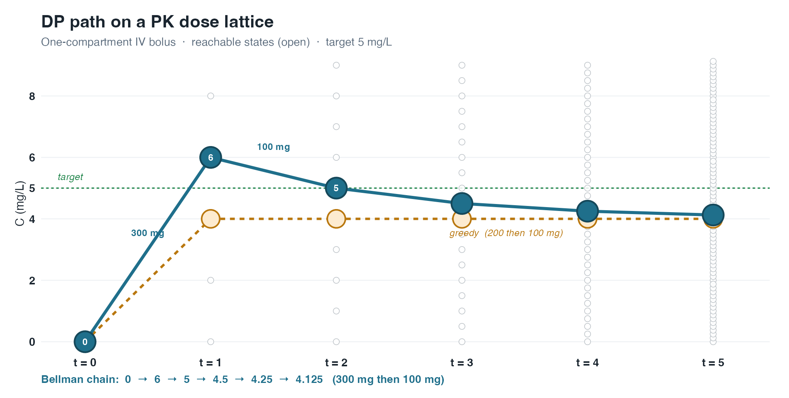

{fig-align="center"}

```{r}
#| label: setup
#| include: false
knitr::opts_chunk$set(collapse = TRUE, comment = "#>")
# Mermaid %%| eval: !expr is not evaluated; skip the engine on PDF instead.
.mermaid_engine <- knitr::knit_engines$get("mermaid")
knitr::knit_engines$set(mermaid = function(options) {
  if (isTRUE(knitr::is_latex_output())) {
    options$echo <- FALSE
    options$include <- FALSE
    return("")
  }
  .mermaid_engine(options)
})
```

# Introduction

A one-compartment intravenous (IV) bolus with known elimination
rate constant $k$ and volume of distribution $V$ is ordinary
pharmacokinetics.[^1] Superposition writes the concentration after
a *given* sequence of doses (Rowland and Tozer, 2011). Steady state
tells you the peak, trough, and average that a *repeating* regimen
will settle to.

Neither object is a **policy** — a rule that selects which dose to
give at each decision point. The clinical question is sequential:

> Which dose now, given where the concentration sits, so that the
> whole remaining trajectory is as close as possible to a target
> concentration, subject to constraints on dose size and frequency?

We want to minimize a **cost** function that penalizes both
deviations from the target concentration and large doses (which may
carry toxicity or inconvenience). This is a finite-horizon control
problem. The pharmacokinetic model supplies the **state
transition** — how concentration evolves under a given dose.
Dynamic programming (DP) chooses the **optimal dose sequence** that
minimizes total cost over the time horizon (Bellman, 1957;
Bertsekas, 2017).

A myopic "greedy" rule that only minimizes the immediate one-step
cost can fail: it may lock onto the wrong concentration plateau
even when it scores each step with the same stage cost the optimal
policy accumulates. DP looks ahead to find a globally better trajectory.

This article implements the optimizer from scratch in R: a
one-compartment IV bolus, five dose options, a five-step horizon,
greedy versus Bellman, and a tight $C_{\max}$ cap that removes the
loading overshoot.

**A clinical caveat, stated first.** Parameters here are **known
exactly**. There is no residual error, no interindividual
variability, no delayed observation, and no Bayesian update.
Therapeutic drug monitoring (TDM) and model-informed precision
dosing (MIPD) live in that missing layer (Sheiner et al., 1979;
Darwich et al., 2017; Keizer et al., 2018). The lattice below is a
teaching control problem. It is not a prescribing rule, not a
protocol dose-finding engine, and not software as a medical device.
ICH M15 concerns model-informed *drug development*, not bedside
automation of this recurrence (ICH, 2026).

[^1]: Amount $A(t)$ in a single well-mixed compartment; $C=A/V$;
first-order elimination $\mathrm{d}A/\mathrm{d}t=-kA$.

```{r}
#| label: packages
library(dplyr, warn.conflicts = FALSE)
library(tidyr)
library(ggplot2)
```

# The PK map

## Continuous-time one-compartment model

After an IV bolus of dose $D$ into volume of distribution $V$, the
concentration evolves as

$$
C(t)=\frac{D}{V}\,e^{-kt}, \qquad
\text{where}\quad
k=\frac{\ln 2}{t_{1/2}}
$$

is the elimination rate constant. For a half-life
$t_{1/2}=12\,\mathrm{h}$, we have $k\approx 0.0578\,\mathrm{h}^{-1}$.

## Discrete-time dosing epochs

Suppose we make dosing decisions at fixed intervals
$\Delta t=12\,\mathrm{h}$ — once per half-life. Between decisions,
the drug is eliminated. The **interval elimination factor** is

$$
r=e^{-k\Delta t}=e^{-\ln 2}=\tfrac12.
$$

This says: concentration halves over one dosing interval in the
absence of new doses.

## The transition map

Let $C_t$ denote the concentration at epoch $t$ (immediately after
the dose at that epoch). A dose $D_t$ chosen at epoch $t$ arrives at
the start of epoch $t+1$; the concentration then is

$$
C_{t+1} = r\,C_t + \frac{D_t}{V},
$$

where the first term accounts for elimination and the second for
the instantaneous bolus. We abbreviate $C_{t+1}$ as $C'$ when the
time index is clear.

## Parameters and action set

With $V=50\,\mathrm{L}$, a $100\,\mathrm{mg}$ bolus raises $C$ by
$2\,\mathrm{mg/L}$. We restrict doses to a discrete set:

$$
D\in\mathcal{D}=\{0,100,200,300,400\}\,\mathrm{mg},
\qquad
u=\frac{D}{V}\in\{0,2,4,6,8\}\,\mathrm{mg/L}.
$$

Here $u$ is the **concentration increment** from a bolus. The
planning horizon is $H=5$ epochs, and we start from $C_0=0$.

```{r}
#| label: params
half_life <- 12
dt <- 12
V <- 50
r <- exp(-log(2) * dt / half_life)
target <- 5
lambda <- 0.02
doses <- c(0, 100, 200, 300, 400)
H <- 5
c0 <- 0

pk_next <- function(c, dose) r * c + dose / V

stage_cost <- function(c_next, dose) {
  u <- dose / V
  (c_next - target)^2 + lambda * u^2
}

c(r = r, V = V, target = target, lambda = lambda, H = H)
```

The PK model does not choose $D$. It only answers: given this $C$
and this $D$, where do we land. The dosing policy comes from
optimizing a **cost function** over multiple steps.

## The cost function and objective

We want the concentration trajectory to stay close to a
target $C_{\mathrm{target}}=5\,\mathrm{mg/L}$ over the five epochs.
The dose chosen at epoch $t$ lands in the state $C_{t+1}$, so the
**stage cost** $L(C_{t+1},D_t)$ incurred there penalizes:

1. **Deviation from target**: $(C_{t+1} - C_{\mathrm{target}})^2$,
   squared to penalize large deviations more heavily.
2. **Dose magnitude**: $\lambda u_t^2$ where $u_t=D_t/V$, to
   discourage unnecessarily large boluses ($\lambda=0.02$ is a
   small weight).

The stage cost is therefore

$$
L(C',D) = (C' - 5)^2 + 0.02\,\left(\frac{D}{V}\right)^2,
$$

where $C'$ is the post-dose concentration after giving $D$. The
**total cost** of a dose sequence $(D_0,D_1,\ldots,D_{H-1})$ is

$$
\text{Total cost} = \sum_{t=0}^{H-1} L(C_{t+1}, D_t),
$$

where $C_{t+1}=r C_t + D_t/V$ under the PK transition. Our goal is
to find the dose sequence that minimizes this total cost.

## The PK-DP feedback loop

The interplay between the PK model and the DP optimization can be
visualized as a feedback loop at each epoch:

```{mermaid}
%%| label: pk-dp-loop
%%| fig-width: 8.0
%%| fig-height: 3.4
%%| out-width: "100%"
%%{init: {"theme": "base", "themeVariables": {"darkMode": false, "background": "#ffffff", "primaryColor": "#d6eaf8", "primaryTextColor": "#1a252f", "primaryBorderColor": "#1f6f8b", "lineColor": "#2c3e50", "mainBkg": "#d6eaf8", "clusterBkg": "#f7f9fb", "clusterBorder": "#5d6d7e", "titleColor": "#1a252f"}, "flowchart": {"padding": 12, "nodeSpacing": 22, "rankSpacing": 36, "curve": "linear"}}}%%
flowchart LR
  subgraph pk [PK transition]
    Cnow["$$C_t$$"]
    Cnext["$$C' = r\cdot C + D/V$$"]
    Cnow --> Cnext
  end
  subgraph dp [DP choice]
    Doses["D in the discrete set"]
    Cost["min L plus  $$\:V_{t+1}$$"]
    Doses --> Cost
  end
  Cost --> Cnext
  classDef hid fill:#d6eaf8,stroke:#1f6f8b,color:#1a252f,stroke-width:1.5px
  classDef pkc fill:#d5f5e3,stroke:#1e8449,color:#1a252f,stroke-width:1.5px
  class Cnow,Cnext pkc
  class Doses,Cost hid
```

```{tikz}
%| label: pk-dp-loop-pdf
%| echo: false
%| eval: !expr knitr::is_latex_output()
%| fig-align: center
%| fig-width: 6.4
\begin{tikzpicture}[
  font=\sffamily,
  hid/.style={
    draw={rgb,255:red,31;green,111;blue,139},
    fill={rgb,255:red,214;green,234;blue,248},
    very thick, minimum height=9.2mm, inner sep=3pt,
    font=\sffamily\bfseries\small,
    text={rgb,255:red,26;green,37;blue,47},
    align=center
  },
  pkc/.style={
    draw={rgb,255:red,30;green,132;blue,73},
    fill={rgb,255:red,213;green,245;blue,227},
    very thick, minimum height=9.2mm, inner sep=3pt,
    font=\sffamily\bfseries\small,
    text={rgb,255:red,26;green,37;blue,47},
    align=center
  },
  arr/.style={->, thick, draw={rgb,255:red,80;green,90;blue,100}},
  panel/.style={
    draw={rgb,255:red,93;green,109;blue,126},
    fill={rgb,255:red,247;green,249;blue,251},
    rounded corners=1.5pt
  }
]
  \draw[panel] (-1.35, 0.55) rectangle (4.55, 2.05);
  \node[font=\sffamily\bfseries\small,
        text={rgb,255:red,26;green,37;blue,47}] at (1.6, 1.82)
    {PK transition};
  \node[pkc] (cnow) at (0.15, 1.05) {$C_t$};
  \node[pkc] (cnext) at (2.95, 1.05) {$C'=rC+D/V$};
  \draw[arr] (cnow) -- (cnext);

  \draw[panel] (5.05, 0.55) rectangle (10.55, 2.05);
  \node[font=\sffamily\bfseries\small,
        text={rgb,255:red,26;green,37;blue,47}] at (7.8, 1.82)
    {DP choice};
  \node[hid] (doses) at (6.35, 1.05) {$D$ discrete};
  \node[hid] (cost) at (9.15, 1.05) {$\min L+V_{t+1}$};
  \draw[arr] (doses) -- (cost);
  \draw[arr] (cost.south) -- ++(0,-0.55) -| (cnext.south);
\end{tikzpicture}
```

**How to read this diagram:**

At each decision epoch $t$, the process unfolds as follows:

1. **Current state (left green box):** We observe the current
   concentration $C_t$ at epoch $t$.

2. **PK transition (right green box):** The pharmacokinetic
   model gives us a **transition function**
   $C' = r\cdot C_t + D/V$. This is pure science — it describes
   how concentration evolves under elimination and dosing. The PK
   model does *not* tell us which dose to choose; it only predicts
   the outcome of any given dose.

3. **DP decision (left blue box):** Dynamic programming
   considers all possible doses $D\in\{0,100,200,300,400\}$ from
   the discrete action set. For each candidate dose, we know where
   it would take us (via the PK transition).

4. **Cost evaluation (right blue box):** For each candidate
   dose, DP computes the **total future cost**:
   - **Immediate cost** $L(C',D)$: how much does landing at $C'$
     cost us at this step?
   - **Future cost-to-go** $V_{t+1}(C')$: what is the minimum cost
     achievable from state $C'$ onward? (This comes from having
     already solved later epochs backward, or from the forward
     table we're building.)

5. **Optimal choice:** DP selects the dose $D$ that minimizes
   $L(C',D) + V_{t+1}(C')$. This is the **lookahead** — it picks
   the dose whose total cost (immediate plus future) is smallest.

6. **State update (arrow from DP back to PK):** The chosen dose is
   applied, the PK transition computes the new concentration $C'$,
   and this becomes $C_{t+1}$ for the next epoch. The loop repeats.

**The key insight:** The PK box is deterministic chemistry and
physiology. The DP box is optimization — it uses the PK predictions
to compare all possible futures and picks the best one. A greedy
policy would ignore the $V_{t+1}$ term and only minimize $L$ now.

# Why greedy is not enough

## The greedy policy

A **greedy** (myopic) policy chooses at each step the dose that
minimizes $L$ *for that step alone*, ignoring future consequences.
Starting from $C_0=0$, let's evaluate the one-step cost for each
possible first dose:

```{r}
#| label: first-step
first_step <- tibble(dose = doses) %>%
  mutate(
    u = dose / V,
    c_next = pk_next(c0, dose),
    sq_err = (c_next - target)^2,
    dose_pen = lambda * u^2,
    L = sq_err + dose_pen
  )
first_step
```

## Why greedy fails

The squared error component **ties** $D=200\,\mathrm{mg}$ (giving
$C'=4$) and $D=300\,\mathrm{mg}$ (giving $C'=6$): both land
$1\,\mathrm{mg/L}$ away from the target. The dose penalty
$\lambda u^2$ breaks the tie in favor of the smaller dose:
$L=1.32$ for $D=200\,\mathrm{mg}$ versus $L=1.72$ for
$D=300\,\mathrm{mg}$.

A greedy policy therefore opens with $200\,\mathrm{mg}$.

From $C=4$, half-life elimination gives $C=2$ before the next
dose. Adding $100\,\mathrm{mg}$ returns $C=4$. Repeating
$200\,\mathrm{mg}$ would give $C=6$, which has higher cost than
$C=4$. So greedy locks onto

$$
D=(200,100,100,100,100)\,\mathrm{mg},
\qquad
C=(4,4,4,4,4).
$$

## The discrete-dose trap

For linear kinetics with constant maintenance dose $u=D/V$, the
steady-state concentration is

$$
C_{\mathrm{ss}} = \frac{u}{1-r}.
$$

With $r=0.5$ and $u=2$ (from $D=100\,\mathrm{mg}$), we get
$C_{\mathrm{ss}}=4$, not the target $5$. To hit $C_{\mathrm{ss}}=5$
would require $u=2.5$, hence $D=125\,\mathrm{mg}$, which is **not
in our discrete set** $\{0,100,200,300,400\}$.

Greedy picks the best available steady state on the grid, which is
$C=4$. But dynamic programming can do better by exploiting
**transient behavior**.

The five arrows out of $C=0$:

```{mermaid}
%%| label: dose-fan
%%| fig-width: 8.5
%%| fig-height: 4.2
%%| out-width: "100%"
%%{init: {"theme": "base", "themeVariables": {"darkMode": false, "background": "#ffffff", "primaryColor": "#d6eaf8", "primaryTextColor": "#1a252f", "primaryBorderColor": "#1f6f8b", "lineColor": "#2c3e50", "mainBkg": "#d6eaf8", "clusterBkg": "#f7f9fb", "clusterBorder": "#5d6d7e", "titleColor": "#1a252f"}, "flowchart": {"padding": 10, "nodeSpacing": 16, "rankSpacing": 48, "curve": "linear"}}}%%
flowchart LR
  S["(t, C = 0)"]
  S -->|"0 mg"| A["C' = 0"]
  S -->|"100 mg"| B["C' = 2"]
  S -->|"200 mg"| G["C' = 4 greedy"]
  S -->|"300 mg"| D["C' = 6 DP"]
  S -->|"400 mg"| E["C' = 8"]
  classDef hid fill:#d6eaf8,stroke:#1f6f8b,color:#1a252f,stroke-width:1.5px
  classDef pkc fill:#d5f5e3,stroke:#1e8449,color:#1a252f,stroke-width:1.5px
  classDef greedy fill:#fdebd0,stroke:#b9770e,color:#1a252f,stroke-width:1.8px
  classDef dp fill:#1f6f8b,stroke:#15485a,color:#ffffff,stroke-width:1.8px
  class S hid
  class A,B,E pkc
  class G greedy
  class D dp
```

```{tikz}
%| label: dose-fan-pdf
%| echo: false
%| eval: !expr knitr::is_latex_output()
%| fig-align: center
%| fig-width: 6.4
\begin{tikzpicture}[
  font=\sffamily,
  hid/.style={
    draw={rgb,255:red,31;green,111;blue,139},
    fill={rgb,255:red,214;green,234;blue,248},
    very thick, minimum width=22mm, minimum height=9mm,
    font=\sffamily\bfseries\small,
    text={rgb,255:red,26;green,37;blue,47},
    align=center
  },
  pkc/.style={
    draw={rgb,255:red,30;green,132;blue,73},
    fill={rgb,255:red,213;green,245;blue,227},
    very thick, minimum width=24mm, minimum height=8.6mm,
    font=\sffamily\small,
    text={rgb,255:red,26;green,37;blue,47},
    align=center
  },
  greedy/.style={
    draw={rgb,255:red,185;green,119;blue,14},
    fill={rgb,255:red,253;green,235;blue,208},
    very thick, minimum width=28mm, minimum height=8.6mm,
    font=\sffamily\bfseries\small,
    text={rgb,255:red,26;green,37;blue,47},
    align=center
  },
  dp/.style={
    draw={rgb,255:red,21;green,72;blue,90},
    fill={rgb,255:red,31;green,111;blue,139},
    very thick, minimum width=24mm, minimum height=8.6mm,
    font=\sffamily\bfseries\small,
    text=white,
    align=center
  },
  arr/.style={->, thick, draw={rgb,255:red,80;green,90;blue,100}}
]
  \node[hid] (s) at (0, 0) {$(t, C=0)$};
  \node[pkc]    (a) at (5.4,  2.4) {$C'=0$};
  \node[pkc]    (b) at (5.4,  1.2) {$C'=2$};
  \node[greedy] (g) at (5.4,  0.0) {$C'=4$ greedy};
  \node[dp]     (d) at (5.4, -1.2) {$C'=6$ DP};
  \node[pkc]    (e) at (5.4, -2.4) {$C'=8$};
  \draw[arr] (s) -- node[font=\sffamily\scriptsize, above] {0 mg} (a);
  \draw[arr] (s) -- node[font=\sffamily\scriptsize, above] {100} (b);
  \draw[arr] (s) -- node[font=\sffamily\scriptsize, above] {200} (g);
  \draw[arr] (s) -- node[font=\sffamily\scriptsize, above] {300} (d);
  \draw[arr] (s) -- node[font=\sffamily\scriptsize, above] {400} (e);
\end{tikzpicture}
```

## The loading overshoot insight

DP asks a different question: what if we pay the higher cost
$L=1.72$ now to reach $C=6$, accepting the overshoot? After one
epoch of elimination, $C$ drops to $3$, and adding
$100\,\mathrm{mg}$ gives

$$
C_{t=2} = 0.5\cdot 6 + 2 = 5,
$$

hitting the target exactly at $t=2$. From there, the trajectory
decays more slowly through $(5, 4.5, 4.25, 4.125)$ — staying
closer to target on average than the greedy path stuck at $4$.

This is the **loading overshoot** strategy. Greedy never considers
it because $1.32<1.72$ at the first step; it cannot see that the
short-term sacrifice buys a better long-term trajectory.

# Bellman's principle and the DP recurrence

## State, action, and transition

A **state** is $(t,C)$ — the current epoch and concentration.
An **action** is a dose $D\in\mathcal{D}$.
The **transition** is $C'=rC+D/V$.

## Value function and cost-to-go

Let $V_t(C)$ denote the **minimum achievable cost** from epoch $t$
onward, starting from concentration $C$ at that epoch. This is
called the **cost-to-go** or **value function**.

At the terminal epoch $t=H$, we incur no further cost:

$$
V_H(C) = 0 \quad \text{for all } C.
$$

For earlier epochs $t<H$, Bellman's principle of optimality states:

$$
V_t(C) = \min_{D\in\mathcal{D}}
\Bigl[
  \underbrace{L(C',D)}_{\text{immediate cost}}
  +
  \underbrace{V_{t+1}(C')}_{\text{future cost-to-go}}
\Bigr],
$$

where $C'=rC+D/V$ is the post-dose concentration. This says: the
optimal cost-to-go equals the immediate stage cost plus the optimal
future cost from the resulting state, minimized over all possible
dose choices.

We solve this **backward** from $t=H$ down to $t=0$, building up
the optimal policy at each state.

## Analogy to other DP problems

This is the same tabular DP pattern as a 0-1 knapsack or longest
common subsequence problem, only the meaning of the state changes
(here a minimization over all five doses at once, not the
knapsack's binary take-or-skip):

| Question | Knapsack | This PK problem |
|---|---|---|
| What is a state? | (item $i$, capacity $w$) | (epoch $t$, concentration $C$) |
| What is a transition? | take / skip the item | PK map $C\mapsto C'$ under $D$ |
| What is terminal? | $i=0$ or $w=0$ | $t=H$, no salvage cost |

## Shortest path interpretation

The same recurrence is a **shortest path** problem on a directed
acyclic graph (DAG). Nodes are reachable states $(t,C)$. Each arrow
from $(t,C)$ to $(t+1,C')$ represents giving dose $D$, with edge
weight $L(C',D)$. We seek the cheapest path from the initial state
$(0,0)$ to any terminal state $(H,C)$ (Bertsekas, 2017).

## Forward versus backward computation

The theoretical formulation above computes $V_t$ backward from
$t=H$ to $t=0$. For a DAG, we can equivalently compute
**cost-to-reach** forward from $t=0$, storing at each node the
minimum cumulative cost to reach that state and the predecessor
state. After reaching $t=H$, we backtrack through predecessors to
reconstruct the optimal path.

The code below uses forward accumulation — analogous to Viterbi
decoding, with $L$ in place of $-\log p$. This is sometimes easier
to implement and matches the natural left-to-right flow of the
dosing timeline.

# Implementation in R

Reachable concentrations under this grid stay a **sparse** set:
five nodes after the first dose, then $13$, $29$, $61$, $125$. A
dense mesh in $C$ is unnecessary. Encode $C$ by rounding when
grouping so that floating keys do not split a state.

```{r}
#| label: solver
reconstruct_path <- function(nodes, H) {
  cur <- nodes %>%
    filter(t == H) %>%
    slice_min(cost, n = 1, with_ties = FALSE)
  acc <- vector("list", H + 1)
  acc[[H + 1]] <- cur
  for (tt in H:1) {
    prev <- nodes %>%
      filter(
        t == tt - 1,
        round(.data$c, 8) == round(cur$prev_c[[1]], 8)
      )
    if (nrow(prev) != 1) {
      stop("predecessor lookup at t=", tt - 1, " matched ",
        nrow(prev), " node(s); states are no longer unique")
    }
    acc[[tt]] <- prev
    cur <- prev
  }
  bind_rows(acc)
}

solve_dose_dp <- function(c_min = -Inf, c_max = Inf) {
  nodes <- tibble(
    t = 0,
    c = c0,
    cost = 0,
    prev_c = NA_real_,
    dose = NA_real_
  )
  for (tt in 0:(H - 1)) {
    layer <- filter(nodes, t == tt)
    expanded <- tidyr::crossing(layer, dose_new = doses) %>%
      mutate(
        c_next = pk_next(c, dose_new),
        cost_next = cost + stage_cost(c_next, dose_new)
      ) %>%
      filter(c_next >= c_min, c_next <= c_max) %>%
      mutate(c_key = round(c_next, 8)) %>%
      group_by(c_key) %>%
      slice_min(cost_next, n = 1, with_ties = FALSE) %>%
      ungroup() %>%
      transmute(
        t = tt + 1,
        prev_c = c,
        c = c_next,
        cost = cost_next,
        dose = dose_new
      )
    nodes <- bind_rows(nodes, expanded)
  }
  list(nodes = nodes, path = reconstruct_path(nodes, H))
}

greedy_policy <- function() {
  c <- c0
  total <- 0
  rows <- vector("list", H)
  for (tt in 1:H) {
    step <- tibble(dose = doses, c_next = pk_next(c, doses)) %>%
      mutate(L = stage_cost(c_next, dose)) %>%
      slice_min(L, n = 1, with_ties = FALSE)
    total <- total + step$L
    rows[[tt]] <- tibble(
      t = tt, c = step$c_next, dose = step$dose, cost = total
    )
    c <- step$c_next
  }
  bind_rows(
    tibble(t = 0, c = c0, dose = NA_real_, cost = 0),
    bind_rows(rows)
  )
}
```

```{r}
#| label: run-unconstrained
dp <- solve_dose_dp()
greedy <- greedy_policy()

n_states <- dp$nodes %>%
  count(t, name = "n_reachable")
n_states

dp$path %>%
  transmute(t, dose, C = c, cost)
greedy %>%
  transmute(t, dose, C = c, cost)
```

DP opens with $300\,\mathrm{mg}$, visits $C=6$, then holds
$100\,\mathrm{mg}$. Greedy opens with $200\,\mathrm{mg}$ and never
leaves $C=4$. After $t=1$ both policies use the same maintenance
dose; the **only** disagreement is the loading bolus. That is the
lookahead.

```{r}
#| label: cost-compare
tibble(
  policy = c("DP (Bellman)", "Greedy (one-step L)"),
  doses = c(
    paste(dp$path$dose[-1], collapse = ", "),
    paste(greedy$dose[-1], collapse = ", ")
  ),
  C_path = c(
    paste(dp$path$c[-1], collapse = ", "),
    paste(greedy$c[-1], collapse = ", ")
  ),
  total_cost = c(last(dp$path$cost), last(greedy$cost))
)
```

Total cost $3.618$ versus $5.64$. The extra $0.40$ paid at the
first step ($1.72$ versus the greedy $1.32$) buys a visit to
$C=5$ at $t=2$ and a slower drift toward the discrete steady state
$4$.

**Why does the DP path decay after $t=2$?** Not because the
objective is blind at the endpoint: the final arrival is priced like
every other one — the last stage cost is $(4.125-5)^2 + 0.08 =
0.846$, close to a quarter of the total. The decay is the
discrete-dose trap at work. Holding $C=5$ would take $125\,\mathrm{mg}$
at every epoch; off that dose, from $C=5$ the only reachable next
states are $\{2.5, 4.5, 6.5, 8.5, 10.5\}$, and $4.5$ (one $100\,\mathrm{mg}$
step, cost $0.33$) is closest to target. The same comparison
recurs at $4.5$ and $4.25$ — cheaper to decay a little than to pay
for a $200\,\mathrm{mg}$ swing back up. A terminal penalty
$(C_H-5)^2$ prices the endpoint, not the flight path: even when we
add it at weight $1$, brute force over all 3125 sequences still
runs the middle of the path through $(6, 5, 4.5)$ before rerouting
the last dose to finish at $5.125$.

```{r}
#| label: fig-trajectories
#| fig-width: 8.2
#| fig-height: 4.3
#| fig-cap: "Post-dose concentration under DP and greedy. Dashed line: target 5 mg/L."
col_dp <- "#1F6F8B"
col_greedy <- "#B9770E"
col_target <- "#1E8449"
col_ink <- "#1A252F"

traj <- bind_rows(
  dp$path %>% transmute(t, c, policy = "DP"),
  greedy %>% transmute(t, c, policy = "Greedy")
)

ggplot(traj, aes(t, c, colour = policy, linetype = policy)) +
  geom_hline(
    yintercept = target, colour = col_target, linewidth = 0.5,
    linetype = "22"
  ) +
  geom_line(linewidth = 0.95) +
  geom_point(size = 2.6) +
  scale_colour_manual(values = c(DP = col_dp, Greedy = col_greedy)) +
  scale_linetype_manual(values = c(DP = "solid", Greedy = "22")) +
  scale_x_continuous(breaks = 0:H) +
  labs(x = "epoch t", y = "C (mg/L)", colour = NULL, linetype = NULL) +
  theme_minimal(base_size = 12) +
  theme(
    legend.position = "top",
    panel.grid.minor = element_blank(),
    axis.title = element_text(colour = col_ink),
    axis.text = element_text(colour = col_ink)
  )
```

# Therapeutic window as a hard constraint

Drop any transition with $C'$ outside $[C_{\min},C_{\max}]$. The
solver does not change; the action set becomes state-dependent.

A *realistic* window for this toy, say $2\le C'\le 8$, still
admits the loading peak of $6$. The Bellman path is unchanged:

```{r}
#| label: window-realistic
dp_win_wide <- solve_dose_dp(c_min = 2, c_max = 8)
dp_win_wide$path %>%
  transmute(t, dose, C = c, cost)
```

A **tight peak cap** $C_{\max}=5.5$ forbids $C'=6$ and $C'=8$ from
$C=0$. The loading overshoot is illegal. DP collapses onto the
greedy opening:

```{r}
#| label: window-tight
dp_win_tight <- solve_dose_dp(c_min = 0, c_max = 5.5)
dp_win_tight$path %>%
  transmute(t, dose, C = c, cost)
```

That is the clinical reading of the constraint: if the protocol
forbids the overshoot that lookahead wanted, the extra future value
of $C=6$ is simply not in the feasible set. The DP path collapses
onto the greedy path not because the algorithm changed, but because
the loading peak is now illegal.

Hard $C_{\max}/C_{\min}$ bounds are one way a therapeutic window
enters this DP. Soft penalties on excursions are the other, milder,
encoding — already present as $(C'-5)^2$ in the stage cost. The
trade-off is: hard constraints guarantee safety but may force a
suboptimal trajectory; soft penalties allow occasional excursions
if the overall cost benefit is large enough.

# What this is not

The state here is a scalar $C$. An oral one-compartment model has
$(A_g,A_c)$ and the map needs $k_a$ as well as $k_e$. A
two-compartment IV model has $(A_c,A_p)$. The Bellman update does
not change; the node key becomes a pair, and the lattice grows
fast. That is the natural sequel, not this post.

Three other missing pieces, on purpose:

- **Unknown $\theta$.** Real MIPD updates $k$ and $V$ from measured
  concentrations (Sheiner et al., 1979; Jelliffe et al., 1993).
  That is Bayesian forecasting, then a *new* open-loop plan — or a
  receding-horizon step of model predictive control (Rawlings,
  Mayne, and Diehl, 2017).
- **Stochastic DP.** Interindividual variability and residual error
  turn $C'$ into a distribution. Expectation of $L$ replaces $L$.
  The table is then an MDP (Puterman, 1994).
- **Continuous $D$ or free times.** A discrete $D$ on a fixed clock
  is what makes the DAG small. Optimizing dose *and* clock is a
  different mixed-integer problem.

PK model + DP + state estimation is sequential dosing
optimization. It is close in spirit to target-concentration
intervention (Holford, 1999) and to MIPD. It is not a substitute
for either until the error model and the update are there.

# When not to use this

- **ADaM tables and CSR displays.** SDTM/ADaM programming is joins,
  windows, and estimators — not a Bellman table.
- **Protocol dose finding.** Phase I/II designs (3+3, CRM, BOIN,
  MCP-Mod) answer a *population* question. This lattice answers an
  individual sequence under a known model.
- **Primary TDM in the clinic.** Use a residual-error model and a
  posterior for $\theta$, then a dose that hits AUC, trough, or
  $C_{\mathrm{ss}}$ (Sheiner et al., 1979; Rowland and Tozer,
  2011). Vancomycin AUC/MIC workflows are in that family, not in
  an open-loop five-step DAG with $\theta$ known.
- **Nonlinear PK** unless you discretize the state after the
  nonlinear map. Superposition is gone; the transition is still a
  function $f(x,u)$, so DP still applies, but the sparse grid of
  this toy will not.
- **Production MIPD software.** Audit, device regulation, and
  covariate models live elsewhere (Darwich et al., 2017; Keizer et
  al., 2018; ICH, 2026). The recurrence above is the teaching
  object you can read.

# Closing

| Method | What it optimizes | Typical failure |
|---|---|---|
| Repeat a labeled $D$ | convenience | wrong $C_{\mathrm{ss}}$ on a coarse grid |
| Myopic / greedy | one-step $L$ | skips the loading overshoot |
| Steady-state formula | peak / trough / $C_{\mathrm{av,ss}}$ | ignores the transient path |
| **DP on the PK DAG** | $\sum_t L(C_{t+1},D_t)$ | known $\theta$; discrete $D$; no error model |
| Bayesian TDM / MIPD | posterior predictive target | needs data, $g(\theta)$, and an update |

Use this DP when the scientific sentence is: **the PK model
supplies the transition, and we want the cheapest feasible dose
sequence on a known discrete set.** Use superposition and
steady-state formulae to understand a *fixed* regimen. Use TDM /
MIPD when $\theta$ is the patient's, not the textbook's.

# References

## Dynamic programming and control

- Bellman, R. (1957). *Dynamic Programming*. Princeton University
  Press.
- Bertsekas, D. P. (2017). *Dynamic Programming and Optimal
  Control*. 4th ed. Athena Scientific.
- Puterman, M. L. (1994). *Markov Decision Processes: Discrete
  Stochastic Dynamic Programming*. Wiley.
  <https://doi.org/10.1002/9780470316887>
- Rawlings, J. B., Mayne, D. Q., and Diehl, M. (2017). *Model
  Predictive Control: Theory, Computation, and Design*. 2nd ed.
  Nob Hill Publishing.

## Pharmacokinetics

- Rowland, M., and Tozer, T. N. (2011). *Clinical Pharmacokinetics
  and Pharmacodynamics: Concepts and Applications*. 4th ed.
  Lippincott Williams and Wilkins.
- Gabrielsson, J., and Weiner, D. (2016). *Pharmacokinetic and
  Pharmacodynamic Data Analysis*. 5th ed. Swedish Pharmaceutical
  Press.
- Gibaldi, M., and Perrier, D. (1982). *Pharmacokinetics*. 2nd ed.
  Marcel Dekker.

## TDM, Bayesian forecasting, and MIPD

- Sheiner, L. B., Beal, S., Rosenberg, B., and Marathe, V. V.
  (1979). Forecasting individual pharmacokinetics. *Clinical
  Pharmacology and Therapeutics*, 26(3), 294–305.
  <https://doi.org/10.1002/cpt1979263294>
- Jelliffe, R. W., Schumitzky, A., Van Guilder, M., Liu, M., Hu,
  L., Maire, P., Gomis, P., Barbaut, X., and Tahani, B. (1993).
  Individualizing drug dosage regimens: roles of population
  pharmacokinetic and dynamic models, Bayesian fitting, and
  adaptive control. *Therapeutic Drug Monitoring*, 15(5), 380–393.
  <https://doi.org/10.1097/00007691-199310000-00005>
- Holford, N. H. G. (1999). Target concentration intervention:
  beyond Y2K. *British Journal of Clinical Pharmacology*, 48(1),
  9–13.
  <https://doi.org/10.1046/j.1365-2125.1999.00971.x>
- Darwich, A. S., Ogungbenro, K., Vinks, A. A., Powell, J. R.,
  Reny, J.-L., Marsousi, N., Daali, Y., Fairman, D., Cook, J.,
  Lesko, L. J., and others (2017). Why has model-informed
  precision dosing not yet become common clinical reality? Lessons
  from the past and a roadmap for the future. *Clinical
  Pharmacology and Therapeutics*, 101(5), 646–656.
  <https://doi.org/10.1002/cpt.659>
- Keizer, R. J., ter Heine, R., Frymoyer, A., Lesko, L. J., Mangat,
  R., and Goswami, S. (2018). Model-informed precision dosing at
  the bedside: scientific challenges and opportunities. *CPT:
  Pharmacometrics and Systems Pharmacology*, 7(12), 785–787.
  <https://doi.org/10.1002/psp4.12353>
- ICH (2026). *ICH M15: General Principles for Model-Informed Drug
  Development*. International Council for Harmonisation.
